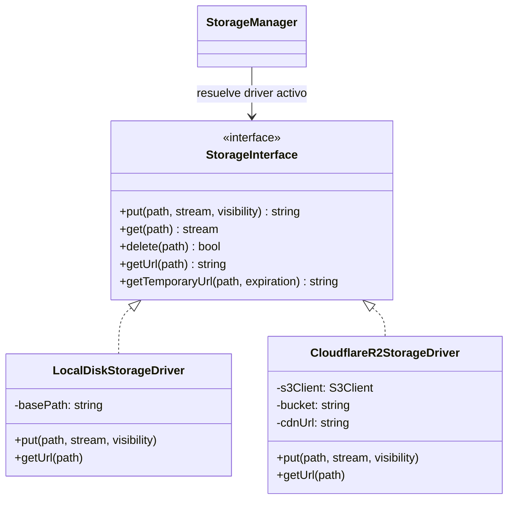

# ARQUITECTURA TÉCNICA Y PROCESAMIENTO MULTIMEDIA — ÁLBUM COLABORATIVO
## DOCUMENTO: ARQUITECTURA_TECNICA_ALBUM.md

---

### 1. PIPELINE DE PROCESAMIENTO DE IMÁGENES

El tratamiento de fotografías evoluciona desde la simple copia de archivos en disco hacia una cadena de procesamiento profesional de 6 etapas:

```mermaid
flowchart TD
    A[Móvil del Invitado: Archivo Seleccionado] --> B[Etapa 1: Pre-compresión Opcional en Cliente Canvas/WebP]
    B --> C[Etapa 2: Subida HTTP Multipart con UUID de Petición]
    
    subgraph Servidor[Pipeline en Servidor Backend]
        C --> D{Etapa 3: Validación de Seguridad}
        D -->|MIME / Magic Bytes / Límites OK| E[Etapa 4: Cálculo de Hash SHA-256 Anti-Duplicados]
        D -->|Extensión o contenido malicioso| ERR[Rechazo 422: Archivo no válido]
        
        E -->|Hash ya existe en este evento| DUP[Aviso 200: Foto ya subida previamente]
        E -->|Hash nuevo| F[Etapa 5: Transcodificación y Generación de Variantes]
        
        F --> V1[Variante Original: storage/media/{id}/photos/original/]
        F --> V2[Variante Display 1920px WebP: storage/media/{id}/photos/display/]
        F --> V3[Variante Thumbnail 400px WebP: storage/media/{id}/photos/thumb/]
        
        V1 & V2 & V3 --> G[Etapa 6: Inserción en BBDD con estado 'pendiente' o 'aprobado']
    end

    G --> H[Notificación a Pantalla en Vivo y Libro 3D]
```

---

### 2. ESPECIFICACIÓN DE FORMATOS Y RESOLUCIÓN DEL PROBLEMA HEIC (iPHONE)

#### El Problema Comprobado con HEIC en `InvitacionAngie`:
En el archivo `api/fotos.php` auditado (líneas 194-205), el código mapeaba el MIME `image/heic` asignándole simplemente la extensión `.jpg`:
```php
// CÓDIGO DEFECTUOSO ACTUAL EN InvitacionAngie:
$allowedMimes = ['image/heic' => 'jpg', 'image/heif' => 'jpg'];
$ext = $allowedMimes[$mime]; // Renombra a .jpg sin convertir los bytes internos
move_uploaded_file($file['tmp_name'], $destPath . '.jpg');
```
*Consecuencia:* El archivo conservaba su compresión interna HEVC/HEIC. Cuando un usuario de Android, Windows o navegadores como Firefox intentaba abrir la foto, **la imagen aparecía rota** porque el navegador esperaba un JPEG legítimo.

#### Solución Definitiva Propuesta:
Se implementa una estrategia de transcodificación en dos capas:
1. **Capa Cliente (Recomendada para rendimiento móvil):**
   - Si el navegador soporta decodificación en cliente (mediante la librería ligera `heic2any` o la API nativa de decodificación de Safari), el archivo se convierte a WebP o JPEG de alta calidad antes de salir del dispositivo del invitado.
2. **Capa Servidor (Garantía de respaldo):**
   - Si llega un archivo HEIC nativo al backend, se utiliza la extensión PHP `imagick` con soporte de decodificación `libheif`:
     ```php
     if ($mime === 'image/heic' || $mime === 'image/heif') {
         $image = new \Imagick();
         $image->readImage($tmpPath);
         $image->setImageFormat('webp');
         $image->setImageCompressionQuality(85);
         $image->writeImage($destinationWebp);
         $image->clear();
     }
     ```

---

### 3. GENERACIÓN DE VARIANTES Y OPTIMIZACIÓN MULTIDISPOSITIVO

Para cada fotografía recibida se generan **tres versiones optimizadas**, resolviendo simultáneamente la necesidad de velocidad en móviles y calidad para descarga familiar:

| Variante | Dimensiones Máximas | Formato | Calidad | Peso Típico | Destino de Uso |
| :--- | :---: | :---: | :---: | :---: | :--- |
| **`thumbnail`** | $400\text{px} \times 400\text{px}$ (Crop centrado o cover) | WebP | 78% | **25 – 45 KB** | Cuadrícula de fotos en la invitación, polaroids del Libro 3D y vista previa del panel admin. |
| **`display`** | $1920\text{px}$ (lado mayor, preservando ratio) | WebP / JPEG | 82% | **250 – 450 KB** | Proyección en Videobeam / TV en vivo (`en-vivo.php`) y apertura en visor Lightbox a pantalla completa. |
| **`original`** | Resolución original del teléfono | Formato original | 100% | **2 – 8 MB** | Preservado intacto para que los padres descarguen el paquete ZIP de alta resolución para impresión en papel. |

---

### 4. DETECCIÓN DE FOTOGRAFÍAS DUPLICADAS

Para evitar que dos invitados suban la misma fotografía (ej. una foto que se pasaron previamente por WhatsApp) o que un invitado presione enviar dos veces:
1. Al recibir el archivo, el servidor calcula el hash criptográfico del contenido binario:
   ```php
   $sha256Hash = hash_file('sha256', $file['tmp_name']);
   ```
2. Se consulta la base de datos:
   ```sql
   SELECT id FROM fotografias_evento 
   WHERE evento_id = :evento_id AND hash_sha256 = :hash AND estado != 'eliminada' 
   LIMIT 1;
   ```
3. Si ya existe, el servidor no almacena bytes duplicados ni genera registros redundantes; retorna un status `200 OK` informando amigablemente: *"Esta fotografía ya se encuentra en el álbum oficial de la fiesta"*.

---

### 5. CAPA DE ABSTRACCIÓN DE ALMACENAMIENTO (`StorageManager`)

Para permitir el cambio de almacenamiento local en disco hacia almacenamiento en la nube (Cloudflare R2 o AWS S3) sin tocar los controladores:



#### Configuración de Rutas de Almacenamiento por Celebración:
```text
storage/
└── media/
    ├── 1/                                  # Celebración #1: Angie Karolina
    │   └── photos/
    │       ├── original/                   # Fotos originales de alta resolución
    │       ├── display/                    # Versiones 1920px WebP para proyector
    │       └── thumb/                      # Miniaturas 400px WebP para cuadrícula
    └── 2/                                  # Celebración #2: Sophia Valentina
        └── photos/
            ├── original/
            ├── display/
            └── thumb/
```
*Garantía Técnica:* Cada celebración tiene su propio espacio de almacenamiento estrictamente particionado. Al eliminar una fiesta o descargar su ZIP, los archivos de otras quinceañeras quedan completamente aislados y a salvo.
