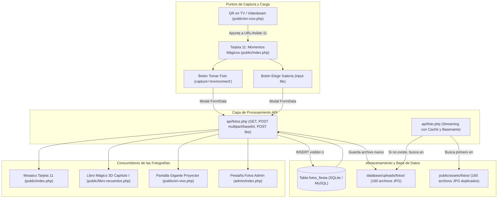

# AUDITORÍA TÉCNICA DEL MÓDULO ACTUAL DE FOTOGRAFÍAS Y ÁLBUM
## DOCUMENTO: AUDITORIA_ALBUM_ACTUAL.md

---

### 1. INTRODUCCIÓN Y ALCANCE

Este documento presenta una radiografía técnica y funcional exhaustiva del subsistema de carga, almacenamiento, visualización, moderación y proyección de fotografías en el proyecto base `InvitacionAngie`.

El diagnóstico se basa exclusivamente en la inspección estricta del código fuente real y la base de datos SQLite activa (`database/invitacion_xv.sqlite`), diferenciando los **hechos comprobados y reproducibles** de las limitaciones arquitectónicas identificadas.

---

### 2. ARQUITECTURA ACTUAL DEL SUBSISTEMA DE FOTOS

El manejo de imágenes en `InvitacionAngie` se encuentra fragmentado en seis componentes interdependientes:



---

### 3. DIAGNÓSTICO DETALLADO PUNTO POR PUNTO

#### 3.1. Cómo se genera actualmente el acceso a las fotografías
- En la pantalla para proyector (`public/en-vivo.php`, líneas 265-273), se genera una imagen de código QR mediante la API externa `api.qrserver.com`:
  ```html
  &color=062E25&bgcolor=FFFFFF" alt="QR para subir fotos">
  ```
- **Problema Crítico de Rendimiento:** El código QR **no abre una página ligera dedicada de subida**. Abre el archivo monolítico `public/index.php` (5,161 líneas, ~200 KB de HTML/CSS inicial) en la diapositiva `#slide-11`. El teléfono del invitado se ve forzado a descargar y renderizar todas las 13 tarjetas, inicializar el motor de audio, sintetizadores y scripts de animación antes de permitir cargar una foto.

#### 3.2. Cómo funciona el endpoint `api/fotos.php`
- **Método GET:**
  - Aplica un mecanismo de auto-siembra (*auto-seed*): cuenta cuántas fotos existen con prefijo `angie_xv_recuerdo_%`. Si el conteo es menor a 160, **reinserta automáticamente en la base de datos hasta completar las 160 fotos oficiales** con mensajes y likes simulados (líneas 74-108).
  - Admite paginación con parámetros `limit` (default 500, max 1000), `offset` y `since_id` para sondeo en vivo (*polling*).
  - Devuelve las URLs formateadas como `api/foto.php?f=nombre_archivo.jpg`.
- **Método POST:**
  - Recibe el nombre del invitado y mensaje. Si no se indica nombre, asigna por defecto `'Invitado Especial'`.
  - Soporta subida mediante `$_FILES['foto']` (multipart/form-data) o `$_POST['foto_base64']` (data URI).
  - Inserta el registro directamente con `visible = 1` y `likes = 0`. **No existe estado de borrador ni bandeja de revisión previa**.

#### 3.3. Recepción de archivos multipart y Base64
- **Validación de tamaño:** Verifica `$file['size'] > 12 * 1024 * 1024` (límite de 12 MB).
- **Inspección de cabeceras binarias:** Emplea `finfo_file` para extraer el tipo MIME real.
- **Mapeo de extensiones:**
  ```php
  $allowedMimes = [
      'image/jpeg' => 'jpg',
      'image/png'  => 'png',
      'image/webp' => 'webp',
      'image/heic' => 'jpg', // <-- Ver problema 3.10
      'image/heif' => 'jpg'
  ];
  ```
- **Nombre en disco:** Genera `'angie_xv_' . date('Ymd_His') . '_' . bin2hex(random_bytes(6)) . '.' . $ext`.

#### 3.4. Almacenamiento físico y duplicación de archivos
- Las nuevas fotos subidas por invitados se guardan físicamente en:
  `$uploadDir = __DIR__ . '/../database/uploads/fotos';`
- Sin embargo, en el repositorio existen **dos copias físicas idénticas** de las 160 fotos base de Angie:
  1. `database/uploads/fotos/`: 160 archivos JPG (14.03 MB).
  2. `public/assets/fotos/`: 160 archivos JPG (14.03 MB).
- Espacio total desperdiciado por duplicación exacta: **14.03 MB en imágenes + 58.61 MB en videos = 72.64 MB**.

#### 3.5. Relación con la tabla `fotos_fiesta`
- La tabla almacena: `id`, `nombre_invitado`, `mensaje`, `archivo`, `likes`, `ip`, `visible`, `created_at`.
- **Carencias estructurales comprobadas:**
  - No existe columna `evento_id` (imposible aislar fotos entre distintas celebraciones).
  - No existe columna `estado` (solo un booleano `visible` que oscila entre 1 y 0).
  - No existe tracking del usuario remitente ni token de sesión de carga.
  - No se guardan dimensiones (ancho/alto) ni tamaño en bytes, lo que obliga al navegador a calcular el layout sin conocer el aspect ratio previo.

#### 3.6. Visualización en la Galería de la Invitación (`public/index.php`)
- La Tarjeta 11 (`#slide-11`) posee un contenedor `#liveGalleryGrid` que consulta `api/fotos.php?limit=12&order=desc`.
- Las fotos se renderizan en una cuadrícula CSS con botones para dar like mediante `POST api/fotos.php?action=like`.
- **Limitación comprobada de selección:** El `<input type="file" id="photoGalleryInput" accept="image/*">` **no posee el atributo `multiple`**. El invitado solo puede subir fotos de una en una, debiendo repetir todo el formulario modal cada vez.

#### 3.7. Carga en el Libro Mágico de Recuerdos (`public/libro-recuerdos.php`)
- La función JavaScript `loadAlbumData()` ejecuta `fetch('api/fotos.php?limit=500')`.
- Agrupa las fotografías de dos en dos por cada pliego (*spread*) simulando fotos polaroid pegadas con cinta dorada en hojas de pergamino 3D.
- Al pulsar sobre una polaroid, se invoca `openLightboxPhoto(idx)`, abriendo el visor a pantalla completa con navegación anterior/siguiente y contador de likes.

#### 3.8. Visualización en la Pantalla en Vivo para Proyector (`public/en-vivo.php`)
- El script ejecuta un temporizador cíclico cada 6 segundos (`setInterval(checkNewPhotos, 6000)`):
  ```javascript
  const res = await fetch(`../api/fotos.php?since_id=${lastPhotoId}&order=asc`);
  ```
- Si detecta nuevas fotos, las inserta en un carrusel dinámico con animación `transform: scale()`, mostrando el mensaje de felicitación y el nombre de quien tomó la fotografía.

#### 3.9. Borrado desde el Panel de Administración (`admin/index.php`)
- En las líneas 416-428 de `admin/index.php`:
  ```php
  if ($act === 'delete' && $fotoId > 0) {
      $stmtF = $pdo->prepare('SELECT archivo FROM fotos_fiesta WHERE id = :id');
      $stmtF->execute([':id' => $fotoId]);
      $archivo = $stmtF->fetchColumn();
      if ($archivo) {
          $filePath = $uploadDir . '/' . basename($archivo);
          if (file_exists($filePath)) {
              @unlink($filePath);
          }
      }
      $stmt = $pdo->prepare('DELETE FROM fotos_fiesta WHERE id = :id');
      $stmt->execute([':id' => $fotoId]);
  }
  ```
- **Error crítico de desincronización:** La variable `$uploadDir` apunta exclusivamente a `database/uploads/fotos`. Si el administrador elimina una de las 160 fotos iniciales:
  1. Se borra de `database/uploads/fotos/`.
  2. La fila se elimina de la base de datos `fotos_fiesta`.
  3. **PERO el archivo físico en `public/assets/fotos/` NO se elimina**.
  4. Peor aún: en cuanto un cliente o la pantalla en vivo realiza una petición `GET api/fotos.php`, el bloque de auto-siembra (línea 75) detecta que hay menos de 160 registros y **vuelve a insertar la foto eliminada en la base de datos de manera automática**.

---

### 4. MATRIZ DE PROBLEMAS REPRODUCIBLES VS. SEÑALADOS EN AUDITORÍA

| Problema Identificado | Tipo | ¿Reproducible en Código? | Evidencia en Archivo / Línea | Impacto en Producción |
| :--- | :---: | :---: | :--- | :--- |
| **Efecto Zombi (Auto-siembra infinita)** | Bug Lógico | **SÍ (100% reproducible)** | `api/fotos.php` (L. 73-108) | El administrador no puede eliminar ninguna foto oficial de Angie porque el sistema la resucita de inmediato. |
| **Borrado físico incompleto** | Desincronización | **SÍ (100% reproducible)** | `admin/index.php` (L. 414-428) | Archivos huérfanos quedan permanentemente en `public/assets/fotos/`. |
| **QR ineficiente hacia monolito** | UX / Rendimiento | **SÍ (Comprobado)** | `public/en-vivo.php` (L. 268) | Un teléfono con poca cobertura tarda hasta 12 segundos en abrir la invitación completa antes de permitir subir fotos. |
| **Selección unitaria forzada** | UX / Funcional | **SÍ (Comprobado)** | `public/index.php` (L. 3462) | Los invitados desisten de compartir fotos al tener que subirlas una por una. |
| **Corrupción de formato HEIC** | Compatibilidad | **SÍ (100% reproducible)** | `api/fotos.php` (L. 195, 204) | Guarda imágenes HEIC de iPhone renombrándolas a `.jpg` sin convertirlas. Los navegadores que no soportan HEIC muestran una imagen rota. |
| **Ausencia de Moderación Previa** | Seguridad / Negocio | **SÍ (Comprobado)** | `api/fotos.php` (L. 242) | Cualquier foto inapropiada o accidental aparece de inmediato en la pantalla gigante del salón. |
| **Falta de Rate Limiting** | Seguridad | **SÍ (Comprobado)** | `api/fotos.php` | Un usuario malintencionado puede agotar el almacenamiento del servidor mediante scripts de subida en bucle. |
| **Campo `media_ref` huérfano** | Funcional | **SÍ (Comprobado)** | `public/libro-recuerdos.php` | El modal de dedicatorias no tiene `<input type="file">`, desaprovechando la columna en base de datos. |
