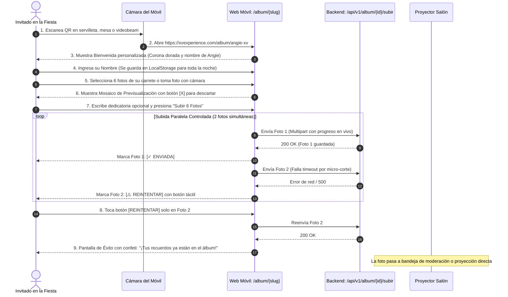

# REDISEÑO DE EXPERIENCIA DE USUARIO (UX/UI) — ÁLBUM COLABORATIVO
## DOCUMENTO: FLUJO_UX_ALBUM_COLABORATIVO.md

---

### 1. FILOSOFÍA DE DISEÑO: "ZERO-FRICTION & PARTY-PROOF"

La experiencia del invitado en una fiesta de quince años se desarrolla en un contexto ruidoso, festivo y con distracciones constantes, operando desde teléfonos móviles sobre redes celulares saturadas o Wi-Fi inestable.

El nuevo flujo del **Álbum Colaborativo** se rige por tres premisas:
1. **Cero Fricción:** Sin descargar aplicaciones, sin crear cuentas, sin contraseñas y sin validaciones de email.
2. **Carga Ultraligera:** La página de carga pesa menos de 45 KB iniciales (a diferencia de los 200+ KB del monolito actual), abriendo en menos de 800 ms en redes 3G/4G.
3. **Resiliencia ante Fallos de Red (*Fault-Tolerant*):** Subida secuencial e independiente archivo por archivo. Si fallan 2 de 5 fotos por una caída momentánea de señal, el invitado **no pierde las 3 que ya subieron ni tiene que volver a seleccionar todo**.

---

### 2. MAPA DEL VIAJE DEL INVITADO (USER JOURNEY)

---

### 3. WIREFRAMES Y ESPECIFICACIÓN DE PANTALLAS MÓVILES

#### Pantalla 1: Bienvenida e Identificación Rápida
- **Encabezado:** Corona/Tiara real vectorizada en SVG en tonos dorados con el título del evento: *"Los XV de Angie Karolina"* (o *"Los XV de Sophia"*).
- **Subtítulo:** *"Comparte tus fotos y sé parte del recuerdo oficial de esta noche mágica ✨"*.
- **Campo de Remitente:** Input de texto amplio con placeholder *"¿Quién toma la foto? (Ej. Tía Carmen / Primos / Lucas)"*.
  - **Memoria Inteligente:** El valor se persiste en `localStorage.getItem('guest_party_name')`. Cuando el invitado vuelva a subir fotos más tarde en la noche, el campo ya estará prellenado.

#### Pantalla 2: Selector Dual (Cámara en Vivo + Galería Múltiple)
- **Botón Primario 1 (Cámara):**
  - Botón táctil grande de $54\text{px}$ de altura, fondo dorado con icono de cámara:
  - `<button type="button" id="btnSnapPhoto"><i class="fas fa-camera"></i> Tomar Foto Ahora</button>`
  - Dispara un input con atributo `capture="environment" accept="image/*"`.
- **Botón Primario 2 (Carrete / Selección Múltiple):**
  - Botón con borde esmeralda y fondo oscuro translúcido:
  - `<button type="button" id="btnPickGallery"><i class="fas fa-images"></i> Elegir Varias del Carrete</button>`
  - Dispara: `<input type="file" id="multiFileInput" multiple accept="image/jpeg,image/png,image/webp,image/heic,image/heif" style="display:none">`.
  - **Diferencia con el sistema actual:** El atributo `multiple` permite marcar de $1$ a $10$ fotografías de una sola vez.

#### Pantalla 3: Bandeja de Previsualización Local (*Staging Grid*)
- Al seleccionar las fotos, se procesan localmente en milisegundos mediante la API `URL.createObjectURL(file)` antes de subir ningún byte a internet.
- Cada miniatura muestra:
  - Imagen en formato cuadrado $100\text{px} \times 100\text{px}$ con esquinas redondeadas.
  - Tamaño estimado en megabytes (ej. `2.4 MB`).
  - Botón flotante superior derecho `[✕]` rojo semitransparente para quitar fotos no deseadas o borrosas antes de enviar.
- **Campo de Dedicatoria Opcional:** Área de texto de 2 líneas: *"Escribe un mensaje o dedicatoria para la quinceañera (Opcional)..."*.

#### Pantalla 4: Ejecución de Envío con Indicadores Individuales
- Al presionar **"¡Compartir X Fotos Ahora!"**:
  - La pantalla no se congela ni muestra un spinner genérico de pantalla completa.
  - Cada tarjeta de foto en la lista muestra su propia barra de progreso de subida porcentual ($0\% \rightarrow 100\%$) mediante `XMLHttpRequest.upload.onprogress` o `fetch` con streams.
- **Estados Visuales de Cada Elemento:**
  1. **En cola:** Icono de reloj ámbar y texto *"Esperando turno..."*.
  2. **Subiendo:** Barra de progreso activa dorada con porcentaje numérico (`64%`).
  3. **Completada con éxito:** Check verde brillante `[✓]` con animación suave de desvanecimiento.
  4. **Fallida por error de conexión:** Borde rojo con botón táctil destacado `[↺ Reintentar]`.

#### Pantalla 5: Confirmación Festiva y Continuidad
- Al completarse el lote:
  - Disparo de confeti dorado mediante `canvas-confetti`.
  - Mensaje de felicitación: *"¡Gracias por compartir tus recuerdos con Angie! ✨🥂"*.
  - Dos botones de acción:
    1. **"Subir Más Recuerdos"** (Limpia la bandeja y permite cargar otro lote).
    2. **"Ver el Álbum en Vivo"** (Abre el visor de fotos de la fiesta).

---

### 4. REGLAS DE RESILIENCIA Y CONECTIVIDAD DEGRADADA

1. **Límite de Concurrencia en Cliente (*Concurrency Pool*):**
   - No disparar 10 peticiones POST pesadas simultáneamente (lo cual saturaría el canal de subida del móvil provocando fallos por *timeout*).
   - El script gestiona una cola (*queue*) que procesa **máximo 2 subidas en paralelo**. A medida que una termina, arranca la siguiente.
2. **Compresión Previa en el Teléfono (*Client-Side Pre-Compression*):**
   - Si el invitado selecciona 5 fotos tomadas con cámaras de 48 MP (pesando 12 MB cada una = 60 MB en total), la red colapsaría.
   - Antes de iniciar la subida, un Web Worker en JavaScript redimensiona la imagen en un `<canvas>` invisible a un tamaño máximo de $1920\text{px}$ en su lado mayor y la comprime a WebP/JPEG calidad 82%.
   - **Resultado:** Una foto de 12 MB se reduce a ~650 KB en 200 milisegundos en el teléfono, subiéndose 18 veces más rápido y con idéntica calidad visual para pantallas y álbumes.
3. **Reintentos Unitarios Idempotentes:**
   - Cada foto lleva un identificador único en cliente (`client_photo_uuid`). Si se reintenta el envío, el servidor reconoce si el archivo ya había sido guardado evitando registros duplicados.
