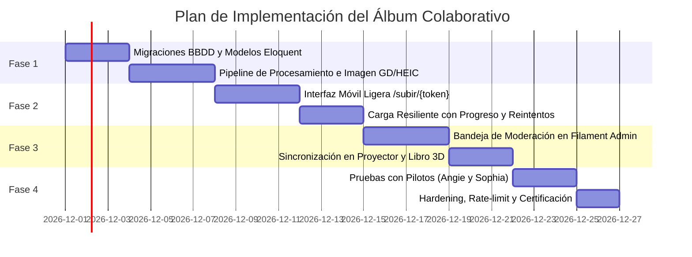

# PLAN DE IMPLEMENTACIÓN TÉCNICA — ÁLBUM COLABORATIVO
## DOCUMENTO: PLAN_IMPLEMENTACION_ALBUM.md

---

### 1. HOJA DE RUTA DE IMPLEMENTACIÓN (SPRINTS Y HITOS)

La integración del nuevo **Álbum Colaborativo Profesional** en el ecosistema **XV Experience** se programa en **4 fases secuenciales**:

---

### 2. DETALLE DE ACTIVIDADES POR FASE

#### FASE 1: Base de Datos, Modelos y Servicio de Procesamiento Multimedia
- **Actividad 1.1:** Ejecución de migraciones para crear `album_colaboradores`, `album_fotografias` y `album_moderacion_logs` con claves foráneas e índices por `evento_id`.
- **Actividad 1.2:** Creación de los modelos Eloquent:
  - `App\Models\AlbumPhoto`: Relaciones `belongsTo(Event::class)` y `belongsTo(AlbumCollaborator::class)`. Scopes locales `scopeApproved()`, `scopePending()`.
  - `App\Models\AlbumCollaborator`.
- **Actividad 1.3:** Creación del servicio `App\Services\ImageProcessingService`:
  - Cálculo de hash SHA-256 para descarte de duplicados binarios.
  - Generación de miniaturas (400px WebP) y display (1920px WebP) con GD / Imagick.
  - Stripping de metadatos EXIF / GPS.
  - Almacenamiento desacoplado mediante `StorageManager`.

---

#### FASE 2: Experiencia Móvil del Invitado (*Frontend Ultraligero*)
- **Actividad 2.1:** Creación de la ruta web `/subir/{token_publico}` gestionada por `GuestUploadController@index`.
- **Actividad 2.2:** Creación de la vista Blade `resources/views/guest/upload-page.blade.php`:
  - Peso total inferior a 45 KB (HTML + CSS inyectado + Vanilla JS).
  - Cero dependencias pesadas de frameworks (sin React ni Vue).
  - Captura de nombre en LocalStorage.
  - Selector de archivos múltiple (`<input type="file" multiple>`) y botón directo de cámara.
- **Actividad 2.3:** Creación del script JavaScript de subida resiliente:
  - Cola de concurrencia de máximo 2 fotos simultáneas.
  - Barra de progreso por cada foto individual.
  - Botón táctil de reintento unitario `[↺ Reintentar]` ante fallos de conexión.

---

#### FASE 3: Bandeja de Moderación y Sincronización en Tiempo Real
- **Actividad 3.1:** Creación del recurso Filament `App\Filament\Resources\AlbumPhotoResource`:
  - Pestañas superiores de estado: *Pendientes de Revisión*, *Aprobadas*, *Rechazadas*, *Eliminadas*.
  - Vista previa de miniatura con modal para ver imagen completa en alta definición.
  - Acciones masivas (*Bulk Actions*): "Aprobar lote seleccionado" y "Rechazar con motivo".
  - Acción de exportación: Descarga en un clic de `fotos_aprobadas.zip` usando `ZipArchive`.
- **Actividad 3.2:** Actualización de los consumidores públicos:
  - **Pantalla en Vivo (`public/en-vivo.php`):** Ajuste de consulta a `view_fotos_aprobadas_publicas` filtrando por `evento_id`.
  - **Libro Mágico 3D (`public/libro-recuerdos.php`):** Carga automática de las nuevas fotos aprobadas en el visor de polaroids.
  - **Galería de la Invitación (Tarjeta 11):** Muestra el conteo de recuerdos actualizados.

---

#### FASE 4: Validación y Despliegue en Celebraciones Piloto
- **Actividad 4.1:** Migración y verificación del Evento #1 (Angie Karolina):
  - Las 160 fotos oficiales quedan registradas con `estado = 'aprobada'` y `es_oficial = 1`.
  - Se verifica que el código QR proyectado en Mérida abra exclusivamente la página de subida de Angie.
- **Actividad 4.2:** Despliegue del Evento #2 (Sophia Valentina):
  - Se genera el QR con token exclusivo de Sophia.
  - Se comprueba que una foto subida por un invitado de Sophia jamás aparezca en la pantalla de Angie ni viceversa.

---

### 3. PROTOCOLO DE PRUEBAS DE CAMPO Y CERTIFICACIÓN

Antes de habilitar el módulo para su venta comercial, se deben superar obligatoriamente las siguientes pruebas de laboratorio:

| Prueba | Dispositivo / Condición de Prueba | Criterio de Aprobación Innegociable |
| :--- | :--- | :--- |
| **Prueba iPhone HEIC** | iPhone 13/14/15 con formato de cámara "Alta Eficiencia" (HEIC nativo). | La foto se transcodifica en cliente/servidor a WebP; se visualiza perfectamente en teléfonos Android y Windows sin errores. |
| **Prueba Micro-Cortes de Red** | Simulación de desconexión de Wi-Fi a mitad de subida de un lote de 6 fotos. | Las 3 fotos ya enviadas quedan guardadas; las 3 pendientes muestran botón `[Reintentar]` sin obligar a reiniciar el lote. |
| **Prueba de Archivo Malicioso** | Envío de un script PHP renombrado a `foto.php.jpg` con código malicioso en los bytes. | El validador `finfo` y el pipeline GD detectan la anomalía, rechazan el archivo y registran el evento en `logs_auditoria`. |
| **Prueba de Carga del Proyector** | Pantalla de proyector encendida durante 4 horas continuas con sondeo cada 6s. | Consumo de memoria RAM plano en el navegador; las fotos aprobadas por el anfitrión aparecen en pantalla en menos de 7 segundos. |
| **Prueba de Aislamiento Multi-Tenant** | Subida de 10 fotos al evento de Angie y 10 fotos al evento de Sophia en simultáneo. | Las fotos de Angie solo son visibles para Angie; las fotos de Sophia solo son visibles para Sophia. Cero contaminación cruzada. |
