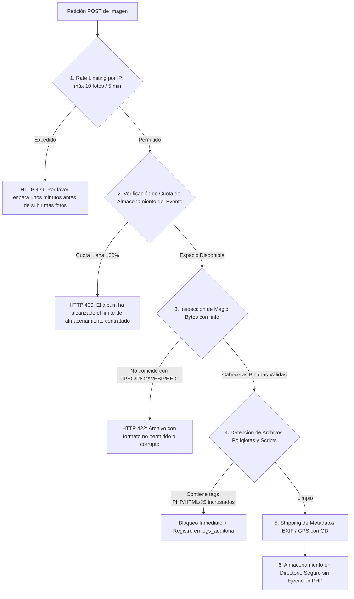

# SEGURIDAD, MODERACIÓN Y CONTROL DE ACCESO — ÁLBUM COLABORATIVO
## DOCUMENTO: SEGURIDAD_Y_MODERACION.md

---

### 1. MODELO DE ACCESO Y SEGURIDAD DEL CÓDIGO QR

Para solventar la brecha detectada en la auditoría (donde el QR abría el archivo maestro de la invitación exponiendo el itinerario y los formularios completos), se diseña un punto de acceso dedicado y seguro:

```text
URL DEL QR EN SALÓN:
https://xvexperience.com/subir/{token_publico_evento}
Ejemplo Angie:  https://xvexperience.com/subir/angie-xv-7f8a9e
Ejemplo Sophia: https://xvexperience.com/subir/sophia-xv-3c2b1d
```

#### Características del Enlace QR Dedicado:
1. **Token Público No Predecible:** Incluye un sufijo aleatorio hexadecimal que impide que un script externo intente adivinar URLs consecutivas (`/subir/1`, `/subir/2`).
2. **Principio de Mínimo Privilegio (*Least Privilege*):**
   - El endpoint **solo y exclusivamente** permite:
     - Renderizar la vista móvil ligera de captura de fotos.
     - Enviar paquetes de imágenes al endpoint `/api/v1/album/{token}/subir`.
   - **Imposibilidad de Fuga de Datos:** La vista de subida **no carga scripts de administración, no contiene endpoints de invitados, no expone listas de confirmados, no revela montos de lluvia de sobres ni permite consultar datos privados de la familia**.
3. **Validación de Estado y Ventana Temporal:**
   - El middleware verifica que `eventos.estado = 'publicado'`.
   - Si la fiesta finalizó hace más de 7 días (y el cliente no contrató extensión), la página muestra un mensaje amistoso: *"El álbum de recepción de fotos ha concluido. ¡Gracias por haber sido parte de esta noche mágica!"*.

---

### 2. DEFENSA EN PROFUNDIDAD CONTRA ABUSO Y MALWARE



#### Medidas Técnicas Específicas:
1. **Neutralización de Archivos Políglotas:**
   - Los atacantes a menudo incrustan código PHP dentro de los comentarios de una imagen JPEG legítima. Al procesar y re-guardar la imagen mediante la librería GD (`imagecreatefromstring` e `imagewebp`), **cualquier payload malicioso es destruido físicamente**, ya que la imagen se re-dibuja pixel por pixel en el servidor.
2. **Protección de la Privacidad del Invitado (Anti-Doxxing):**
   - Los smartphones modernos incrustan coordenadas GPS exactas de dónde se tomó la foto en los metadatos EXIF. La re-codificación elimina el 100% de las etiquetas EXIF antes de que la foto se guarde en disco o se proyecte en pantalla.
3. **Desactivación de Ejecución en la Carpeta de Almacenamiento:**
   - La carpeta `storage/media/` cuenta con un archivo `.htaccess` dedicado:
     ```apache
     <FilesMatch "\.(php|phtml|php3|php4|php5|php7|phps|cgi|pl|exe)$">
         Require all denied
     </FilesMatch>
     Options -Indexes -ExecCGI
     ```

---

### 3. DISEÑO DE LA BANDEJA DE MODERACIÓN (PANEL DE ANFITRIÓN / SUPERADMIN)

Para que los padres de la quinceañera no teman que aparezcan imágenes vergonzosas o accidentales en la pantalla gigante frente a los 200 asistentes:

```text
BANDEJA DE MODERACIÓN DE FOTOGRAFÍAS (Estados del Flujo):
├── 1. PENDIENTES DE REVISIÓN (Fotos recién subidas por los invitados)
├── 2. APROBADAS (Visibles en la Pantalla en Vivo, Galería y Libro 3D)
├── 3. RECHAZADAS (Ocultas, con motivo: "Movida", "Repetida", "No adecuada")
└── 4. ELIMINADAS (Borrado lógico con opción de purga física controlada)
```

#### Modos de Operación Configurables por el Anfitrión:
El anfitrión puede alternar entre dos modos de funcionamiento según su preferencia:
- **Modo Moderación Previa (Recomendado para máxima tranquilidad):** Toda foto nueva entra con `estado = 'pendiente'`. El anfitrión o el organizador la revisa desde su teléfono móvil en `/anfitrion/album` y presiona un botón verde `[✓ Aprobar]`. Solo entonces se dispara a la pantalla gigante.
- **Modo En Vivo Directo (Para máxima diversión y espontaneidad):** Las fotos entran con `estado = 'aprobada'` inmediatamente y aparecen en el proyector en 6 segundos. El anfitrión dispone de un botón de emergencia `[🚫 Ocultar de Inmediato]` en su panel para bajar cualquier foto indebida en un clic.

#### Acciones Masivas y Descarga:
- **Aprobación / Rechazo por Lotes:** Casillas de verificación para seleccionar 20 fotos y marcarlas con un solo clic como *"Aprobar Seleccionadas"*.
- **Exportación Segura a ZIP:** Un botón genera en segundo plano un archivo comprimido `fotos_aprobadas_xv_angie.zip` conteniendo las fotos originales de alta resolución con los nombres de quienes las tomaron en el prefijo del archivo (`20261004_TiaCarmen_foto01.jpg`).
