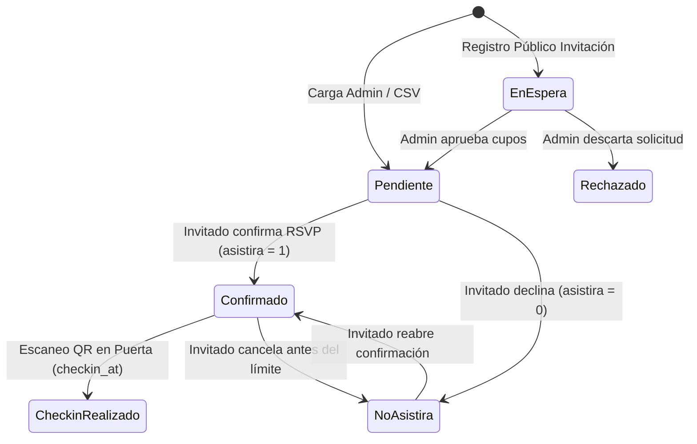

# ARQUITECTURA DE GESTIÓN INTELIGENTE DE INVITADOS — FASE 2

**Plataforma:** XV Experience  
**Módulo:** Gestión de Invitados, RSVP Inteligente & Enlaces Seguros  
**Autor:** Arquitecto de Software Senior  
**Estado:** Especificación de Diseño (Pendiente de Aprobación para Implementación)  

---

## 1. OBJETIVO DEL MÓDULO

Diseñar un subsistema robusto, escalable y seguro para la administración integral de invitados que permita:
1. Administrar invitados formalmente con control de cupos autorizados y grupos familiares.
2. Permitir el registro de correo electrónico desde la invitación digital para recibir copias y recordatorios, **sin que el registro público otorgue automáticamente cupos no autorizados**.
3. Generar enlaces mágicos protegidos por tokens criptográficos únicos (`token_seguro`).
4. Mantener la compatibilidad total e integridad referencial con los pases VIP existentes y los códigos de rifa (`codigo_rifa`).

---

## 2. MODELO DE DATOS AMPLIADO (MIGRACIÓN NO DESTRUCTIVA)

Para preservar la totalidad de los datos existentes de Angie Karolina y Sophia Valentina, la evolución del esquema se realiza mediante adiciones de columnas con valores predeterminados seguros (`DEFAULT`).

### 2.1 Tabla `invitados` (Evolución de Esquema)
Columnas existentes:
- `id` (INTEGER PRIMARY KEY AUTOINCREMENT)
- `nombre_completo` (TEXT NOT NULL)
- `asistira` (INTEGER DEFAULT 0)
- `codigo_rifa` (TEXT)
- `asistio_evento` (INTEGER DEFAULT 0)
- `checkin_at` (DATETIME NULL)
- `created_at` (DATETIME DEFAULT CURRENT_TIMESTAMP)
- `evento_id` (INT NOT NULL DEFAULT 1)

Nuevas columnas a incorporar:
- `email` (VARCHAR(150) NULL): Correo electrónico del invitado principal (indexado).
- `telefono` (VARCHAR(30) NULL): Teléfono móvil para WhatsApp o emergencias.
- `grupo_familiar` (VARCHAR(100) NULL): Nombre de la familia o grupo (ej. *"Familia Rivas González"*).
- `pases_autorizados` (INT NOT NULL DEFAULT 1): Cantidad máxima de personas permitidas (titular + acompañantes).
- `estado_asistencia` (VARCHAR(20) NOT NULL DEFAULT 'pendiente'):
  - `'pendiente'`: Invitación entregada, aún no responde.
  - `'confirmado'`: Confirmó asistencia (`asistira = 1`).
  - `'no_asistira'`: Declinó invitación (`asistira = 0`).
  - `'en_espera'`: Registro público pendiente de aprobación administrativa.
- `token_seguro` (VARCHAR(64) NULL UNIQUE): Token hexadecimal de 64 caracteres criptográficamente seguro para enlaces mágicos (`/e/sophia-xv?t={token_seguro}`).
- `fecha_confirmacion` (DATETIME NULL): Timestamp exacto de la confirmación.
- `preferencias_comunicacion` (TEXT NULL): Objeto JSON que almacena:
  ```json
  {
    "recibir_recordatorios": true,
    "recibir_album_final": true,
    "opt_out": false
  }
  ```
- `origen_registro` (VARCHAR(30) NOT NULL DEFAULT 'admin'): `'admin'`, `'importacion_csv'`, `'invitacion_publica'`.
- `notas_admin` (TEXT NULL): Observaciones privadas (mesa asignada, restricciones dietéticas, alergias).

### 2.2 Tabla `comunicaciones_log` (Nueva)
Registra la trazabilidad de cada comunicación enviada a un invitado:
```sql
CREATE TABLE IF NOT EXISTS comunicaciones_log (
    id INTEGER PRIMARY KEY AUTOINCREMENT,
    evento_id INT NOT NULL,
    invitado_id INT NOT NULL,
    canal VARCHAR(20) NOT NULL DEFAULT 'email', -- 'email', 'whatsapp', 'sms'
    tipo_comunicacion VARCHAR(50) NOT NULL,    -- 'invitacion_digital', 'confirmacion_rsvp', 'recordatorio_7d', etc.
    destinatario VARCHAR(150) NOT NULL,
    asunto VARCHAR(255) NULL,
    resend_email_id VARCHAR(100) NULL,
    estado VARCHAR(30) NOT NULL DEFAULT 'queued', -- 'queued', 'sent', 'delivered', 'bounced', 'failed'
    detalles_error TEXT NULL,
    intentos INT NOT NULL DEFAULT 1,
    created_at DATETIME DEFAULT CURRENT_TIMESTAMP,
    updated_at DATETIME DEFAULT CURRENT_TIMESTAMP,
    FOREIGN KEY (evento_id) REFERENCES eventos(id) ON DELETE CASCADE,
    FOREIGN KEY (invitado_id) REFERENCES invitados(id) ON DELETE CASCADE
);

CREATE INDEX IF NOT EXISTS idx_comms_evento_invitado ON comunicaciones_log(evento_id, invitado_id);
CREATE INDEX IF NOT EXISTS idx_comms_resend_id ON comunicaciones_log(resend_email_id);
```

---

## 3. DOBLE MODALIDAD DE REGISTRO

### 3.1 Modalidad A: Gestión Administrativa y Carga Masiva (Lista Oficial)
- **Flujo:** Los padres de Sophia o el administrador cargan la lista de familiares y amigos mediante el Dashboard.
- **Importación Masiva (CSV/Excel):**
  - Formato: `Nombre, Apellido, Email, Teléfono, Grupo Familiar, Cupos Autorizados, Notas`.
  - El sistema genera automáticamente para cada fila:
    1. Un registro en `invitados` con `pases_autorizados = N` y `estado_asistencia = 'pendiente'`.
    2. Un `token_seguro` criptográfico único (64 hex).
    3. Un `codigo_rifa` único con prefijo del evento (ej. `XV-SOPHIA-4821`).
- **Envío de Invitación Digital Personalizada:**
  - El administrador puede enviar invitaciones masivas o individuales vía Resend con el enlace seguro:
    `https://xvexperience.com/e/sophia-xv?t={token_seguro}`

### 3.2 Modalidad B: Registro de Correo desde la Invitación Digital
- **Flujo del Invitado:** Al navegar la tarjeta de confirmación de la invitación digital, el usuario ingresa su correo electrónico.
- **Reglas de Negocio Estrictas:**
  1. **Si el correo ya pertenece a un invitado pre-autorizado:**
     - El sistema lo reconoce inmediatamente.
     - Carga sus cupos autorizados asignados por la familia (ej. *"Tienes 3 pases reservados para tu familia"*).
     - Le permite confirmar quiénes asistirán.
     - Le envía su Pase VIP oficial al correo.
  2. **Si el correo NO está en la lista previa de invitados:**
     - El sistema **NO crea cupos automáticos ni confirma asistencia**.
     - Guarda el correo en estado `'en_espera'` bajo la etiqueta *"Registro Público / Interesado"*.
     - Envía un correo elegante de acuse de recibo: *"Hemos registrado tu solicitud para acompañar a Sophia Valentina. La familia revisará la disponibilidad de cupos"*.
     - Notifica al administrador en el panel para su aprobación o asignación manual de pases.
- **Protección Antispam y Anti-Abuso:**
  - Campo *Honeypot* oculto para bots (`website_url_check`).
  - Límite de tasa (*Rate Limiting*): máximo 3 intentos por IP cada 15 minutos.
  - Validación sintáctica y de registros DNS MX del dominio del correo.

---

## 4. CICLO DE VIDA DEL INVITADO Y ENLACES MÁGICOS



---

## 5. ENDPOINTS Y CONTROLADORES

| Ruta | Método | Controlador | Propósito |
| :--- | :--- | :--- | :--- |
| `/api/invitados/confirmar` | `POST` | `GuestController::confirm` | Confirmación de asistencia (RSVP) con token o ID |
| `/api/invitados/registro-publico` | `POST` | `GuestController::publicRegister` | Registro de correo desde invitación para recibir copia |
| `/api/invitados/consultar-token` | `GET` | `GuestController::getByToken` | Carga de datos personalizados al abrir enlace mágico |
| `/api/invitados/importar-csv` | `POST` | `GuestController::importCsv` | Importación masiva administrativa de invitados |
| `/api/invitados/exportar-csv` | `GET` | `GuestController::exportCsv` | Exportación completa de confirmaciones y asistencias |
| `/api/invitados/toggle-optout` | `POST` | `GuestController::toggleOptOut` | Derecho del invitado a dejar de recibir recordatorios |

---

## 6. SEGURIDAD Y PRIVACIDAD DE DATOS (GDPR / PRIVACY FIRST)

1. **Tokens Criptográficos Inmunes a Fuerza Bruta:** Generados con `bin2hex(random_bytes(32))` (256 bits de entropía). Imposibles de adivinar secuencialmente, previniendo ataques IDOR.
2. **Privacidad en Galerías Públicas:** Los correos electrónicos y teléfonos jamás se exponen en las respuestas de la API del álbum colaborativo ni en la pantalla en vivo.
3. **Derecho a Supresión (Opt-out):** Cada correo enviado incluirá en el pie de página un enlace de un clic para cancelar recordatorios opcionales sin invalidar su pase al evento.
