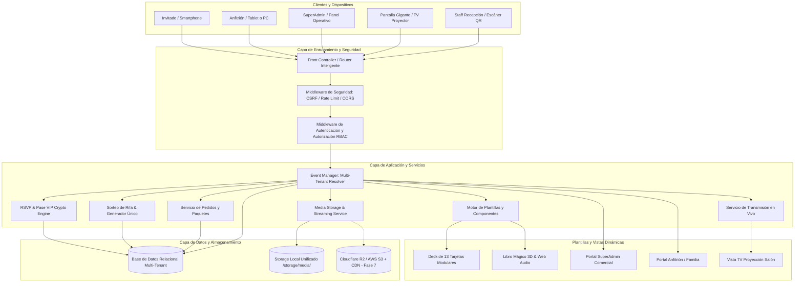

# ARQUITECTURA DE SOFTWARE — PLATAFORMA "XV EXPERIENCE"
## DOCUMENTO 01: ARQUITECTURA GENERAL PROPUESTA

---

### 1. VISIÓN GENERAL DEL PRODUCTO

**XV Experience** es una plataforma web comercial multicliente (*Multi-Tenant Software as a Service*) concebida para transformar celebraciones de quinceañeras y eventos sociales en experiencias digitales interactivas, memorables y automatizadas.

A diferencia de las tarjetas de invitación estáticas tradicionales (archivos PDF o sitios web informativos planos), **XV Experience** ofrece un ecosistema integral en tiempo real compuesto por:
1. **Invitación Digital de Gala:** Navegación por tarjetas (*Deck Slider*) con música, historia, cuenta regresiva, trivia interactiva, itinerario, playlist colaborativa y lluvia de sobres.
2. **Sistema VIP de Recepción y Control de Acceso:** Confirmación de asistencia (RSVP) con generación instantánea de Pase VIP digital dotado de código QR criptográfico, códigos únicos para sorteos de regalos y escáner móvil WebRTC en puerta de acceso.
3. **Muro y Proyector en Vivo (*Live Party Screen*):** Transmisión en tiempo real en pantallas gigantes o televisores del salón con las fotos y dedicatorias capturadas por los invitados desde sus teléfonos móviles.
4. **Libro Mágico de Recuerdos 3D (*Grimoire Edition*):** Experiencia táctil y tridimensional de paso de páginas con simulación física, sonido de pergamino sintetizado por software, galerías fotográficas polaroid, videos con streaming adaptativo y firmas digitales.
5. **Portal de Gestión Comercial y Autogestión:** Panel centralizado para la administración de clientes, pedidos, plantillas, personalización y control de anfitriones.

---

### 2. PRINCIPIOS RECTORES DEL DISEÑO ARQUITECTÓNICO

El diseño arquitectónico de XV Experience se rige por cinco pilares fundamentales derivados de los hallazgos de la auditoría técnica previa:

```text
+---------------------------------------------------------------------------------------------------+
|                                  PRINCIPIOS DE DISEÑO ARQUITECTÓNICO                             |
+---------------------------------------------------------------------------------------------------+
| 1. Evolución No Destructiva: No reconstruir desde cero. Conservar y encapsular los ~11,200 líneas |
|    de código funcional existente, abstrayendo sus componentes sin romper el evento de Angie.      |
| 2. Multi-Tenancy Aislado por Software: Una sola base de código e infraestructura gestiona         |
|    múltiples eventos independientes mediante partición lógica estricta por "evento_id" y "slug".  |
| 3. Desacoplamiento Absoluto (Capa de Presentación vs. Datos): Eliminar el hardcoding. Toda        |
|    variable de diseño, contenido, fotos y fechas debe provenir del motor de persistencia.        |
| 4. Cero Dependencia de Fallback Silencioso en Producción: Desactivar SQLite en producción. El     |
|    sistema debe garantizar integridad transaccional en un motor relacional robusto (MySQL/MariaDB).|
| 5. Alta Disponibilidad de Medios y Desempeño: Separar los archivos estáticos y multimedia pesada |
|    del procesamiento de CPU de PHP, facilitando la transición a almacenamiento Cloudflare R2 / S3.|
+---------------------------------------------------------------------------------------------------+
```

---

### 3. COMPARATIVA: ARQUITECTURA AUDITADA VS. ARQUITECTURA PROPUESTA

| Dimensión Técnica | Estado Actual Auditado (`InvitacionAngie`) | Estado Propuesto (`XV Experience`) | Justificación Técnica del Cambio |
| :--- | :--- | :--- | :--- |
| **Capacidad de Eventos** | **Mono-Evento exclusivo:** Datos de Angie incrustados directamente en el código. | **Multi-Celebración nativa:** Soporte para $N$ eventos simultáneos aislados por `evento_id` y resueltos por subdominio o slug (`/evento/{slug}`). | Permite comercializar el servicio a decenas de clientes sin duplicar proyectos ni servidores. |
| **Organización del Código** | **Monolitos híbridos masivos:** `public/index.php` (5,161 líneas), `admin/index.php` (2,126 líneas) mezclando HTML, CSS, JS y SQL. | **Arquitectura Modular en Capas (Action-Domain-Responder / MVC ligero):** Separación en Core, Controladores, Servicios, Componentes de Vista y Repositorios. | Facilita el mantenimiento, testeo, reutilización y escalabilidad del equipo de desarrollo. |
| **Motor de Plantillas** | **Inexistente:** El diseño está acoplado permanentemente al tema verde esmeralda y oro. | **Motor de Plantillas y Componentes Parametrizables:** Temas desacoplados mediante Tokens CSS, layouts modulares y manifiestos JSON. | Posibilita ofrecer catálogos de diseños (Princesa Rosa, Noche Estelar, Minimalista, etc.) al instante. |
| **Gestión de Base de Datos** | **Híbrida con Fallback Silencioso:** Si MySQL falla, conmuta a SQLite sin avisar. Archivo `schema.sql` desactualizado. | **Relacional Estricta (MySQL/MariaDB InnoDB):** Manejo estricto de errores de conexión. Migraciones versionadas y aislamiento transaccional. | Evita bloqueos de concurrencia (*database is locked*) cuando cientos de invitados interactúan a la vez. |
| **Seguridad y Control de Acceso** | **Contraseñas fijas en código:** Endpoints críticos de check-in e invitados públicos sin autenticación. Sin CSRF. | **RBAC (Role-Based Access Control) con JWT / Sesiones seguras:** Roles `SuperAdmin`, `Anfitrión` y `Staff`. Tokens anti-CSRF y Rate Limiting. | Cumplimiento de estándares de privacidad de datos personales y protección de accesos administrativos. |
| **Almacenamiento de Multimedia** | **Duplicación redundante en disco local:** 145 MB duplicados en `database/uploads/` y `public/assets/`. Streaming servido por PHP. | **Estrategia Unificada con Abstracción de Storage:** Carpeta única centralizada con adaptador listo para Cloudflare R2 / AWS S3 + CDN. | Reduce costos de almacenamiento en 50% y previene saturación de workers de PHP por streaming de video. |

---

### 4. DIAGRAMA ARQUITECTÓNICO DE BLOQUES DE LA PLATAFORMA

A continuación se ilustra la topología integral propuesta para el ecosistema **XV Experience**:



---

### 5. ESPECIFICACIÓN DEL RESOLVER MULTI-INQUILINO (*TENANT RESOLVER*)

Para que una sola instalación sirva a decenas de quinceañeras de manera transparente, el sistema implementará un componente denominado `TenantResolver`:

1. **Resolución por Subdominio:**
   - Ejemplo: `https://angie.xvexperience.com` o `https://sophia.xvexperience.com`.
   - El resolver extrae el prefijo de host y busca en la tabla `eventos` donde `subdominio = :subdominio`.
2. **Resolución por Ruta / Slug:**
   - Ejemplo: `https://xvexperience.com/evento/angie-xv` o `https://xvexperience.com/evento/sophia-xv`.
   - El router captura el parámetro `slug` y consulta `eventos WHERE slug = :slug AND estado = 'publicado'`.
3. **Inyección de Contexto Global:**
   - Una vez identificado el evento, se instancia un objeto inmutable `CurrentEventContext` que acompaña el ciclo de vida de la petición:
     - `CurrentEventContext::getId()`
     - `CurrentEventContext::getSlug()`
     - `CurrentEventContext::getThemeConfig()`
     - `CurrentEventContext::getActiveFeatures()`
   - Todos los modelos y consultas posteriores filtran de manera obligatoria y automática por `evento_id = CurrentEventContext::getId()`.
