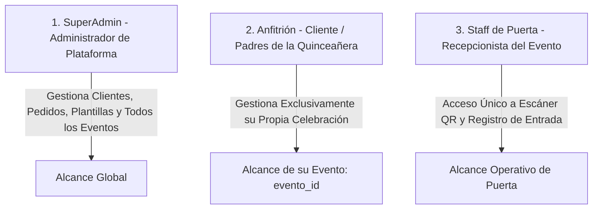

# ARQUITECTURA DE SOFTWARE — PLATAFORMA "XV EXPERIENCE"
## DOCUMENTO 06: DISEÑO DE ROLES, PERMISOS Y SEGURIDAD

---

### 1. MODELO DE CONTROL DE ACCESO BASADO EN ROLES (RBAC)

Para superar la vulnerabilidad crítica detectada en la auditoría (un solo usuario administrativo con contraseñas fijas en código fuente), **XV Experience** implementa un modelo RBAC estructurado en **3 roles jerárquicos**:



---

### 2. MATRIZ DETALLADA DE PERMISOS

| Módulo / Acción Funcional | SuperAdmin | Anfitrión (Host) | Staff Recepción | Invitado Anónimo |
| :--- | :---: | :---: | :---: | :---: |
| **Crear / Eliminar Eventos y Clientes** | SÍ | NO | NO | NO |
| **Configurar Precios, Paquetes y Plantillas** | SÍ | NO | NO | NO |
| **Editar Datos de la Celebración (Textos, Fechas, Padres)** | SÍ | SÍ (Solo su evento) | NO | NO |
| **Subir / Modificar Fotos de Portada y Galería Base** | SÍ | SÍ (Solo su evento) | NO | NO |
| **Consultar Lista de Invitados y Exportar a CSV** | SÍ | SÍ (Solo su evento) | NO | NO |
| **Descargar Archivo ZIP de Fotografías** | SÍ | SÍ (Solo su evento) | NO | NO |
| **Girar Ruleta de Sorteo de Rifa en Vivo** | SÍ | SÍ (Solo su evento) | NO | NO |
| **Escanear QR y Registrar Asistencia (Check-in)** | SÍ | SÍ | SÍ (Solo su evento) | NO |
| **Ver Pantalla de Proyección en Vivo (`en-vivo.php`)** | SÍ | SÍ | SÍ | SÍ (Si tiene URL) |
| **Completar Formulario RSVP y Obtener Pase VIP** | SÍ | SÍ | SÍ | SÍ |
| **Subir Fotos desde Celular y Enviar Dedicatorias** | SÍ | SÍ | SÍ | SÍ |

---

### 3. MECANISMO DE AUTENTICACIÓN Y GESTIÓN DE SESIONES

#### A. Autenticación Web (SuperAdmin y Anfitrión):
- **Almacenamiento de Contraseñas:** Algoritmo nativo `password_hash($pass, PASSWORD_ARGON2ID)` (o `PASSWORD_BCRYPT` con costo 12). Se prohíbe terminantemente almacenar contraseñas en texto plano o usar hashes débiles como MD5/SHA1.
- **Configuración de Cookies de Sesión:**
  ```ini
  session.cookie_httponly = 1
  session.cookie_secure = 1
  session.cookie_samesite = "Strict"
  session.use_strict_mode = 1
  ```
- **Rotación de ID de Sesión:** Ejecución obligatoria de `session_regenerate_id(true)` tras un inicio de sesión exitoso para prevenir ataques de fijación de sesión (*Session Fixation*).

#### B. Autenticación de Staff de Puerta (Escáner QR):
- Para no obligar al personal de protocolo del salón a memorizar contraseñas complejas, el Anfitrión puede generar desde su panel un **Token Temporal de Recepción** con código QR.
- Al escanear este enlace especial (`/staff/checkin?token=eyJhbG...`), el dispositivo del recepcionista obtiene un token de solo lectura/check-in con vigencia de 12 horas, que autoriza únicamente el consumo de `api/checkin.php`.

---

### 4. DEFENSA EN PROFUNDIDAD Y REMEDIACIÓN DE HALLAZGOS DE AUDITORÍA

#### A. Eliminación del Fallback Silencioso a SQLite en Producción:
- **Diagnóstico de la Auditoría:** Si MySQL fallaba, la aplicación conmutaba silenciosamente a SQLite. En un entorno multi-inquilino, esto ocasionaría que eventos distintos intenten escribir en el mismo archivo local, corrompiendo datos o bloqueando el sistema.
- **Diseño Propuesto:**
  ```php
  // config/database.php
  if (getenv('APP_ENV') === 'production') {
      // En producción, solo se permite MySQL/MariaDB.
      // Si la conexión falla, se detiene la ejecución y se emite error 503 Service Unavailable controlado.
      try {
          $pdo = new PDO($dsnMysql, $user, $pass, $options);
      } catch (PDOException $e) {
          error_log("CRITICAL DB FAILURE: " . $e->getMessage());
          http_response_code(503);
          exit(json_encode(['success' => false, 'error' => 'Servicio temporalmente no disponible']));
      }
  } else {
      // SQLite queda restringido EXCLUSIVAMENTE a entornos locales de desarrollo (dev/testing).
  }
  ```

#### B. Protección Estricta contra CSRF (Cross-Site Request Forgery):
- Todos los formularios administrativos y peticiones destructivas (eliminar invitados, purgar fotos, conmutar visibilidad) deben incluir un campo oculto `csrf_token`.
- En cada sesión se almacena un token criptográfico generado con `bin2hex(random_bytes(32))`.
- El middleware `CsrfMiddleware` intercepta todas las peticiones `POST`, `PUT` y `DELETE`, comparando el token recibido con el de la sesión mediante `hash_equals()`. Si no coinciden, se aborta con HTTP 403 Forbidden.

#### C. Rate Limiting Basado en Token Bucket (Protección Anti-DDoS y Spam):
Para prevenir que scripts automatizados llenen el almacenamiento de fotos o bombardeen el formulario de RSVP, el `RateLimitMiddleware` establece límites estrictos por dirección IP:

| Endpoint | Límite Máximo Permitido | Acción ante Exceso |
| :--- | :---: | :--- |
| `POST /api/confirmar.php` (RSVP) | 5 intentos por minuto por IP | Bloqueo temporal por 15 minutos (HTTP 429 Too Many Requests) |
| `POST /api/fotos.php` (Subida de fotos) | 10 fotos cada 5 minutos por IP | HTTP 429 con mensaje amigable para el invitado |
| `POST /api/canciones.php` (Playlist) | 3 sugerencias por minuto por IP | HTTP 429 |
| `POST /admin/login` (Inicio de sesión) | 5 intentos fallidos en 10 minutos | Bloqueo de IP por 30 minutos con alerta por correo |

#### D. Sanitización y Validación Robusta de Archivos Multimedia:
1. **Validación de Cabeceras Reales:** Validación con `finfo` (MIME sniffing) contra una lista blanca cerrada (`image/jpeg`, `image/png`, `image/webp`).
2. **Re-codificación / Stripping de Metadatos EXIF:**
   - Para proteger la privacidad de los invitados, las fotos subidas pasan por una rutina de procesamiento con la librería GD (`imagecreatefromstring` y `imagewebp`), que **elimina automáticamente las coordenadas GPS y datos personales incrustados en los metadatos EXIF**.
3. **Almacenamiento Fuera del DocumentRoot Público:**
   - Ningún archivo subido por un usuario se almacena en rutas donde pueda ejecutarse código PHP. Los archivos se renombran con hashes hexadecimales aleatorios y se sirven a través del controlador `PhotoApiController`.

#### E. Aislamiento de Datos entre Clientes (Tenant Data Isolation):
- Todo controlador que ejecute consultas de base de datos añade de forma no negociable la condición `WHERE evento_id = :current_evento_id`.
- Se implementará un `EventRepository` centralizado que encapsula todas las consultas preparadas, haciendo imposible que una consulta omita accidentalmente el filtro de aislamiento.
- Se auditan todas las operaciones críticas en la tabla `logs_auditoria` con IP, fecha, ID de usuario y JSON con el estado previo y posterior.
