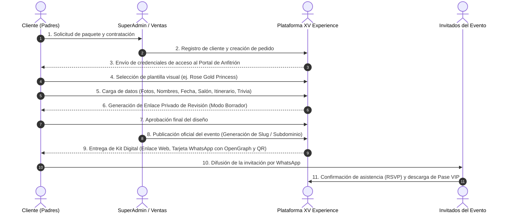

# ARQUITECTURA DE SOFTWARE — PLATAFORMA "XV EXPERIENCE"
## DOCUMENTO 07: FLUJO DE ADMINISTRACIÓN, OPERACIÓN Y ENTREGA COMERCIAL

---

### 1. FLUJO DE VIDA COMERCIAL DEL SERVICIO

El ciclo de vida comercial de una invitación en **XV Experience** sigue una secuencia de 8 etapas claramente definidas:



---

### 2. LOS 3 MODOS OPERATIVOS DEL EVENTO

Un evento en la plataforma atraviesa 3 estados temporales automatizados que adaptan el comportamiento de la interfaz de acuerdo al cronograma:

```text
+---------------------------------------------------------------------------------------------------+
| 1. MODO PRE-EVENTO (Desde la publicación hasta el día de la fiesta):                              |
|    • Foco principal: Emoción, cuenta regresiva, confirmación de asistencia y expectativas.        |
|    • Módulos activos: Deck de 13 tarjetas, RSVP con emisión de Pases VIP, Playlist colaborativa,  |
|      Trivia interactiva, Mapa y Recordatorio en Google Calendar.                                 |
|    • Módulos en espera: El Libro 3D muestra mensaje "Estará disponible la noche de la fiesta".    |
+---------------------------------------------------------------------------------------------------+
                                         │
                                         ▼
+---------------------------------------------------------------------------------------------------+
| 2. MODO DURANTE EL EVENTO (Noche de la celebración - 12 a 24 horas):                              |
|    • Foco principal: Recepción fluida, dinamismo en el salón y participación de los invitados.     |
|    • Módulos activos:                                                                             |
|      - Escáner WebRTC en puerta de acceso para control de asistentes con beep sonoro.             |
|      - Pantalla de Proyección en Vivo (`en-vivo.php`) en TV/Videobeam con sondeo cada 6s.        |
|      - Módulo de subida de fotos instantáneas desde smartphones de los presentes.                 |
|      - Ruleta animada de Sorteo de Rifa en vivo desde el panel del anfitrión con sonido y fanfarria.|
+---------------------------------------------------------------------------------------------------+
                                         │
                                         ▼
+---------------------------------------------------------------------------------------------------+
| 3. MODO POST-EVENTO (A partir del día siguiente - Vigente según paquete contratado):              |
|    • Foco principal: Gratitud, preservación de recuerdos y revivir los mejores momentos.          |
|    • Módulos activos:                                                                             |
|      - Apertura completa del Libro Mágico 3D con las 160+ fotos oficiales y videos en streaming.  |
|      - Muro de dedicatorias abierto para dejar mensajes de cariño y dar likes.                    |
|      - Descarga para los padres del archivo ZIP completo con todas las fotos tomadas.             |
|      - Tarjeta RSVP se transforma automáticamente en mensaje de agradecimiento.                   |
+---------------------------------------------------------------------------------------------------+
```

---

### 3. ESPECIFICACIÓN DEL PANEL SUPERADMIN (OPERACIONES GLOBALES)

El panel accesible en `/admin/` para administradores generales ofrece:

1. **Dashboard de Métricas Generales:**
   - Total de eventos activos, eventos del mes, invitados totales confirmados y almacenamiento en disco consumido (GB).
2. **Gestión de Celebraciones (CRUD Eventos):**
   - Alta de nuevos eventos vinculados a un cliente.
   - Conmutador de estado: *Borrador*, *Publicado*, *Pausado*, *Archivado*.
   - Selector de plantilla asignada y opción de clonación de configuración.
3. **Gestión de Paquetes y Planes Comerciales:**
   - Edición de límites (cantidad de invitados, capacidad de video, acceso a proyector).
4. **Visor de Auditoría Global (`logs_auditoria`):**
   - Registro de inicios de sesión, borrados masivos, fallos de autenticación y bloqueos de seguridad por rate-limit.

---

### 4. ESPECIFICACIÓN DEL PORTAL DE ANFITRIÓN (SELF-SERVICE)

Cada cliente dispone de su propio portal privado en `/anfitrion/` (autenticado contra su `evento_id`):

```text
PORTAL DEL ANFITRIÓN (Estructura de Pantallas):
├── 1. Mi Celebración (Resumen en Tiempo Real):
│   ├── Contador de Titulares Confirmados vs. Acompañantes.
│   ├── Total de Pases Emitidos y Conteo de Presentes en Puerta.
│   └── Enlaces rápidos para compartir por WhatsApp o abrir la invitación.
│
├── 2. Diseñador y Personalización:
│   ├── Editor de Textos: Historia, bendición de padres, itinerario.
│   ├── Editor de Trivia: 5 preguntas y respuestas con opciones múltiples.
│   ├── Carga de Fotos Principales: Portada, marco de gala y música MP3.
│   └── Selector de Paleta de Colores de Vestimenta sugerida.
│
├── 3. Lista de Invitados & Pases:
│   ├── Buscador en tiempo real por nombre, acompañante o código de rifa.
│   ├── Registro manual de invitados que confirman por llamada telefónica.
│   ├── Descarga en un clic del archivo CSV para el organizador/salón.
│   └── Generador del Token de Recepción para el personal de puerta.
│
├── 4. Noche de la Fiesta (Herramientas en Vivo):
│   ├── Botón para abrir la Pantalla de Proyector en Vivo (`en-vivo.php`).
│   ├── Sorteador de Rifa con Ruleta animada y sonido para proyectar en salón.
│   └── Moderador de Fotos en tiempo real (ocultar fotos borrosas o no deseadas).
│
└── 5. Libro de Recuerdos y Archivos:
    ├── Revisión de dedicatorias y firmas de amigos.
    └── Descarga de archivo ZIP con todas las fotos capturadas en la fiesta.
```
