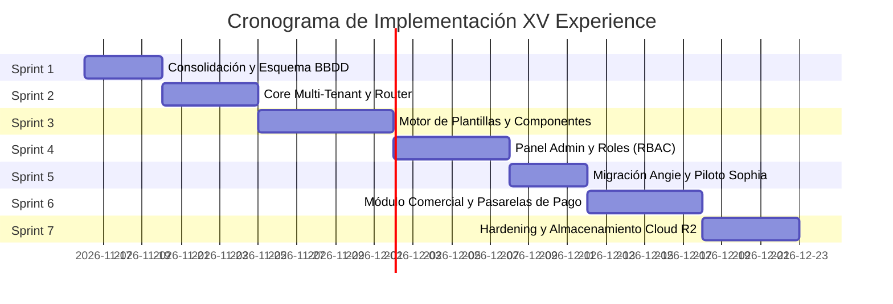

# ARQUITECTURA DE SOFTWARE — PLATAFORMA "XV EXPERIENCE"
## DOCUMENTO 10: ROADMAP DE IMPLEMENTACIÓN TÉCNICA POR ETAPAS

---

### 1. CRONOGRAMA MAESTRO DE EJECUCIÓN

La implementación de **XV Experience** se divide en **7 Sprints de ingeniería controlados**, garantizando pruebas de regresión constantes y cero tiempo de inactividad (*zero downtime*) para el evento de Angie:

---

### 2. DESGLOSE TÉCNICO DETALLADO POR SPRINT

#### SPRINT 1: Consolidación Inicial y Modelo Relacional
- **Objetivo:** Subsanar los errores identificados en la auditoría y desplegar el nuevo esquema de base de datos multi-tenant en MySQL.
- **Entregables:**
  - Corrección del borrado físico de fotos en `admin/index.php`.
  - Corrección de la ruta `/admin/` en `public/index.php`.
  - Ejecución de las migraciones SQL con las 15 tablas nuevas descritas en el Documento 03.
  - Desactivación del fallback silencioso a SQLite en entornos de producción.
- **Criterio de Aceptación (DoD):** Todas las tablas existen en MySQL con sus índices y Foreign Keys, y el evento de Angie continúa funcionando localmente.

---

#### SPRINT 2: Core Multi-Inquilino (*Multi-Tenant*) y Enrutamiento Inteligente
- **Objetivo:** Construir el Front Controller centralizado y el `TenantResolverMiddleware`.
- **Entregables:**
  - `public/index.php` unificado con soporte de reglas `.htaccess`.
  - Clase `Router.php` que captura peticiones hacia `/evento/{slug}`, `/admin` y `/api/*`.
  - Inyección de contexto inmutable `CurrentEventContext`.
- **Criterio de Aceptación (DoD):** Peticiones a `/evento/angie-xv` y `/evento/test-xv` resuelven correctamente el contexto de evento respectivo desde la base de datos.

---

#### SPRINT 3: Motor de Plantillas y Componentización
- **Objetivo:** Dividir los archivos masivos de 5,000 líneas en layouts limpios y 13 componentes de tarjeta modulares.
- **Entregables:**
  - Estructura `templates/components/card-00` a `card-12`.
  - Layout del Libro Mágico 3D (`templates/layouts/grimoire-book.php`) desacoplado de los datos de Angie.
  - Implementación del sistema de inyección de tokens CSS en el `<head>`.
  - Creación del paquete de tema `esmeralda-real` y `rose-gold-princess`.
- **Criterio de Aceptación (DoD):** La invitación de Angie se renderiza exactamente igual visualmente, pero su código fuente ahora está distribuido en componentes limpios y legibles de menos de 150 líneas cada uno.

---

#### SPRINT 4: Panel Administrativo con Roles (RBAC) y Seguridad
- **Objetivo:** Reestructurar el panel de control, incorporando autenticación segura y separación entre SuperAdmin y Anfitrión.
- **Entregables:**
  - Tablas `roles`, `usuarios` y `logs_auditoria` operativas.
  - Vistas separadas para SuperAdmin (`/admin/`) y Anfitrión (`/anfitrion/`).
  - Integración de tokens anti-CSRF en todos los formularios POST.
  - Protección de endpoints de check-in e invitados con tokens de autorización.
  - Módulo de ruleta de rifa y escáner WebRTC funcionando con contexto de evento.
- **Criterio de Aceptación (DoD):** Un anfitrión autenticado solo puede ver y moderar los invitados y fotos de su propio evento.

---

#### SPRINT 5: Migración Oficial de Angie y Puesta en Marcha del Piloto Sophia
- **Objetivo:** Migrar los datos de Angie Karolina al nuevo modelo y activar la celebración de Sophia Valentina.
- **Entregables:**
  - Ejecución de los scripts de migración de datos para Angie (`evento_id = 1`).
  - Consolidación de archivos físicos en `storage/media/1/` (eliminando los 145 MB duplicados).
  - Alta del evento de Sophia (`evento_id = 2`) con plantilla `rose-gold-princess`.
  - Verificación cruzada: Ambos enlaces funcionan en simultáneo sin interferencias.
- **Criterio de Aceptación (DoD):** Ambas invitaciones responden en sus respectivos slugs con datos, colores y fotos completamente diferenciados.

---

#### SPRINT 6: Módulo Comercial, Pedidos y Automatización
- **Objetivo:** Habilitar el flujo de ventas, selección de paquetes y aprovisionamiento automático.
- **Entregables:**
  - Módulo de cotización y checkout en línea.
  - Integración con pasarelas de pago (Stripe, PayPal, MercadoPago o transferencias manuales validadas por admin).
  - Generación automática de eventos en estado "Borrador" tras confirmación de pago.
- **Criterio de Aceptación (DoD):** Un nuevo cliente puede seleccionar un paquete en la web pública, completar su orden y recibir sus credenciales de anfitrión automáticamente.

---

#### SPRINT 7: Almacenamiento Cloud (R2/S3), Hardening y Optimización Final
- **Objetivo:** Blindar la plataforma para alta concurrencia y optimizar la entrega de video y fotos.
- **Entregables:**
  - Adaptador `MediaStorageService` con soporte para Cloudflare R2 / AWS S3.
  - Conversión automática de imágenes a formato WebP optimizado al momento de la subida.
  - Implementación de `RateLimitMiddleware` contra ataques de fuerza bruta y spam.
  - Auditoría de penetración de solo lectura para certificar el cierre de vulnerabilidades.
- **Criterio de Aceptación (DoD):** Plataforma lista para soportar eventos de más de 500 invitados concurrentes con tiempos de respuesta menores a 200 ms.
