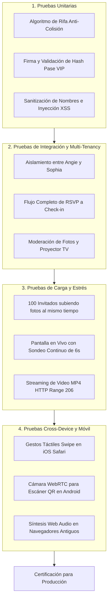

# ARQUITECTURA DE SOFTWARE — PLATAFORMA "XV EXPERIENCE"
## DOCUMENTO 12: PLAN INTEGRAL DE PRUEBAS Y VALIDACIÓN

---

### 1. ESTRATEGIA DE ASEGURAMIENTO DE CALIDAD (QA)

Para validar que la transición de `InvitacionAngie` hacia **XV Experience** sea impecable, se establece un marco de pruebas multinivel que cubre aspectos funcionales, de seguridad, de concurrencia y de compatibilidad móvil.

---

### 2. MATRIZ DE CASOS DE PRUEBA CRÍTICOS

#### A. Pruebas de Aislamiento Multi-Tenant (Crucial):
| Caso de Prueba | Procedimiento de Verificación | Resultado Esperado | Criterio de Éxito |
| :--- | :--- | :--- | :--- |
| **TC-TENANT-01: Aislamiento de Invitados** | Consultar `api/invitados.php` en el contexto del Evento 2 (Sophia) teniendo 50 invitados registrados en el Evento 1 (Angie). | La respuesta solo devuelve los invitados correspondientes a Sophia (cero datos de Angie). | **PASA** si `total_registros` refleja únicamente el evento consultado. |
| **TC-TENANT-02: Aislamiento de Rifa** | Girar la ruleta de rifa en el panel del Evento 2 (Sophia). | Los boletos participantes solo provienen de los confirmados del Evento 2. | **PASA** si ningún boleto de Angie aparece en el selector o animación. |
| **TC-TENANT-03: Moderación de Fotos** | Un anfitrión borra una foto de su fiesta en `/anfitrion/media`. | La foto se elimina exclusivamente de `fotografias_evento WHERE evento_id = X`. | **PASA** si la foto de la fiesta vecina no es afectada. |

#### B. Pruebas de Algoritmos Críticos:
| Caso de Prueba | Procedimiento de Verificación | Resultado Esperado |
| :--- | :--- | :--- |
| **TC-RAFFLE-01: Anti-colisión de Boletos** | Simular la inserción masiva de 1,000 pases con códigos de rifa en bucle cerrado. | Cero colisiones en la tabla `invitados` y `acompanantes` mediante constraint `UNIQUE(evento_id, codigo_rifa)`. |
| **TC-VIP-01: Verificación de Firma QR** | Generar un Pase VIP para el ID 12 y alterar manualmente el código a ID 13 sin regenerar el hash MD5. | El escáner de recepción en `api/checkin.php` rechaza el código informando "Pase no válido o alterado". |

---

### 3. PRUEBAS DE CARGA Y CONCURRENCIA

Se establecen pruebas de rendimiento mediante herramientas estándar (como Apache JMeter o k6):

1. **Prueba de Picos de Confirmación (RSVP Burst):**
   - **Escenario:** 100 peticiones POST concurrentes a `api/confirmar.php` simulando el momento en que se envía el mensaje masivo por WhatsApp.
   - **Métricas exigidas:** Tiempo de respuesta medio $< 450\text{ ms}$, cero errores 500 y correcta ejecución de transacciones InnoDB sin bloqueos de tabla.
2. **Prueba de Proyección en Vivo Constante:**
   - **Escenario:** Pantalla en vivo proyectando ininterrumpidamente durante 6 horas continuas con peticiones `GET api/fotos.php?since_id=X` cada 6 segundos.
   - **Métricas exigidas:** Cero fugas de memoria en el navegador (consumo de RAM plano en Chrome) y carga de CPU del servidor $< 5\%$.
3. **Prueba de Concurrencia de Video:**
   - **Escenario:** 20 dispositivos reproduciendo simultáneamente fragmentos de videos MP4 del Libro 3D mediante peticiones con encabezados `Range: bytes=0-1048576`.
   - **Métricas exigidas:** Respuestas HTTP 206 inmediatas sin congelamiento de la interfaz.

---

### 4. MATRIZ DE COMPATIBILIDAD DE DISPOSITIVOS

| Dispositivo / Navegador | Resolución de Prueba | Funcionalidades a Validar |
| :--- | :---: | :--- |
| **iPhone (iOS 15 - 18) / Safari** | $375\text{px} \times 812\text{px}$ y $414\text{px} \times 896\text{px}$ | Swipe vertical sin rebote indeseado, desbloqueo de audio nativo al primer toque, streaming HTTP Range 206 y descarga de ticket PNG con Html2Canvas. |
| **Android (10 - 15) / Google Chrome** | $360\text{px} \times 800\text{px}$ y $412\text{px} \times 915\text{px}$ | Cámara WebRTC para escaneo QR, rendimiento de animaciones Canvas, confeti y síntesis de sonido en Web Audio API. |
| **Android / Samsung Internet** | $384\text{px} \times 854\text{px}$ | Renderizado de tipografías web (Great Vibes) y apertura del modal de dedicatorias. |
| **Smart TV / Laptop Proyector** | $1920\text{px} \times 1080\text{px}$ (Full HD) | Modo pantalla completa en `public/en-vivo.php`, contraste visual de fotos y legibilidad de textos a 10 metros de distancia. |
| **Desktop (Chrome, Edge, Firefox)** | $1366\text{px} \times 768\text{px}$ y $1920\text{px} \times 1080\text{px}$ | Apertura en doble página del Libro 3D, animación de sombras de página y funcionamiento de la ruleta de sorteos en el panel de anfitrión. |

---

### 5. CHECKLIST DE CERTIFICACIÓN PARA PASE A PRODUCCIÓN (GO-LIVE)

- [ ] **Aislamiento Multi-Tenant Certificado:** Verificado que ningún usuario puede acceder a datos de otro evento.
- [ ] **SQLite Restringido:** Comprobado que en producción solo opera MySQL/MariaDB con InnoDB.
- [ ] **CSRF Tokens Activos:** Verificado que los formularios administrativos rechazan peticiones sin token válido.
- [ ] **Rate Limiting Operativo:** Comprobado que se bloquea el spam en el formulario RSVP tras superar 5 envíos por minuto.
- [ ] **Retrocompatibilidad de Angie:** Comprobado que los enlaces existentes de Angie Karolina abren sin error 404 ni desconfiguración visual.
- [ ] **Permisos de Archivos:** Verificado que los directorios de subida `storage/media/` tienen permisos estrictos (`755` para carpetas, `644` para archivos) y no permiten ejecución de código PHP.
- [ ] **Copias de Seguridad (Backup):** Configurado cronjob automatizado de respaldo diario de la base de datos MySQL y del almacenamiento multimedia.
