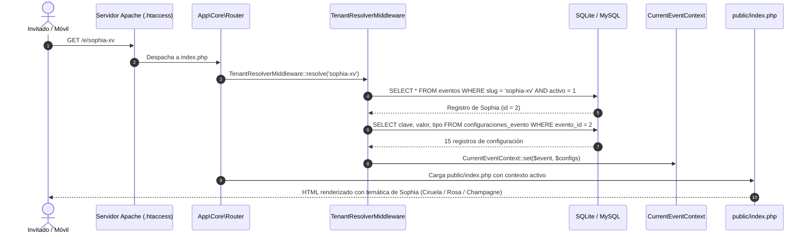

# 04 — AUDITORÍA DEL SISTEMA MULTI-TENANT
**Plataforma:** XV Experience  
**Fecha:** 25 de Noviembre de 2026  
**Especialidad:** Arquitectura SaaS Multi-Tenant y Seguridad

---

## 1. MECANISMO DE RESOLUCIÓN DE INQUILINOS (TENANT RESOLUTION)

La plataforma utiliza una estrategia de resolución por **ruta limpia / subruta (`/e/{slug}`)** complementada por parámetro de consulta (`?evento={slug}`) y subdominio.



---

## 2. AISLAMIENTO DE DATOS POR CELEBRACIÓN (MATRIZ DETALLADA)

| Entidad / Componente | Mecanismo de Aislamiento | ¿Aislado entre Angie y Sophia? | Evidencia / Observación Técnica |
| :--- | :--- | :---: | :--- |
| **Invitados Titulares** | Clave foránea `evento_id` en tabla `invitados`. | **SÍ (100%)** | `SELECT COUNT(*) FROM invitados WHERE evento_id = 1` no retorna invitados del evento 2. |
| **Acompañantes** | Vinculados a `invitado_id` (que a su vez pertenece a un `evento_id`). | **SÍ (100%)** | Las listas de acompañantes están contenidas dentro del árbol del invitado. |
| **Confirmaciones RSVP** | Petición incluye `evento_id`. Inserción vincula `evento_id`. | **SÍ (100%)** | Duplicados evaluados estrictamente con `WHERE evento_id = :ev AND nombre = :nom`. |
| **Pases VIP y Códigos** | Prefijo generado dinámicamente según el slug. | **SÍ (100%)** | Angie genera `XV-ANGIE-...` y Sophia genera `XV-SOPHIA-...`. |
| **Fotografías Galería** | Columna `evento_id` en tabla `fotos_fiesta`. | **SÍ (100%)** | `GET api/fotos.php?evento_id=2` retorna 0 fotos de Angie y 0 fotos oficiales de fiesta. |
| **Fotografías Subidas QR** | `FormData` adjunta `evento_id`. Almacenamiento en disco. | **SÍ (100%)** | Se registran en `fotos_fiesta` con el `evento_id` del formulario móvil. |
| **Pantalla en Vivo** | JavaScript inicializa `const eventoId = X`. Polling dinámico. | **SÍ (100%)** | Cada pantalla consulta exclusivamente las fotos de su celebración. |
| **Libro de Recuerdos** | Columna `evento_id` en `libro_recuerdos`. | **SÍ (100%)** | Las dedicatorias se leen con `WHERE evento_id = :evento_id`. |
| **Videos de Gala** | Almacenados en `public/assets/videos/`. | **PARCIAL** | `api/libro.php` retorna por defecto los 19 videos de Angie cuando Sophia no tiene videos propios. |
| **Sugerencias Musicales** | Tabla `canciones`. | **NO** | [api/canciones.php](file:///c:/Users/troni/Documents/Descarga-Antigravity/InvitacionAngie/api/canciones.php) no tiene columna `evento_id`. Todas las canciones sugeridas son globales. |
| **Listado General Invitados**| [api/invitados.php](file:///c:/Users/troni/Documents/Descarga-Antigravity/InvitacionAngie/api/invitados.php) | **NO** | `SELECT * FROM invitados` devuelve los confirmados de todos los eventos. |
| **Check-in QR en Puerta** | [api/checkin.php](file:///c:/Users/troni/Documents/Descarga-Antigravity/InvitacionAngie/api/checkin.php) | **PARCIAL** | Soporta búsqueda por ID de invitado, pero la validación por regex busca `/XVANGIE-(\d+)/i`. |

---

## 3. IDENTIFICADORES HARDCODED Y MECANISMOS DE FALLBACK

### 3.1 Ocurrencias de Fallbacks a Angie (`evento_id = 1`)
1. **[app/Middleware/TenantResolverMiddleware.php](file:///c:/Users/troni/Documents/Descarga-Antigravity/InvitacionAngie/app/Middleware/TenantResolverMiddleware.php#L27-L29):**
   ```php
   if (!$slug) {
       $slug = 'angie-xv';
   }
   ```
   *Impacto:* Si un usuario visita la raíz `/`, carga Angie Karolina. Esto es correcto para la página por defecto, pero si un usuario consulta un slug inexistente como `/e/celebracion-falsa`, la línea 38 intenta cargar `id = 1` en lugar de retornar HTTP 404 Not Found.
2. **[api/confirmar.php](file:///c:/Users/troni/Documents/Descarga-Antigravity/InvitacionAngie/api/confirmar.php#L135-L136):**
   ```php
   $eventoId = isset($data['evento_id']) ? (int)$data['evento_id'] : ...;
   if ($eventoId <= 0) $eventoId = 1;
   ```
   *Impacto:* Si una petición no envía `evento_id`, se asocia automáticamente a Angie Karolina.
3. **[api/fotos.php](file:///c:/Users/troni/Documents/Descarga-Antigravity/InvitacionAngie/api/fotos.php#L80-L82):**
   ```php
   if ($eventoId <= 0) {
       $eventoId = 1;
   }
   ```

---

## 4. ESCENARIO DE ESCALABILIDAD: ¿QUÉ OCURRE AL AGREGAR UNA 3ª, 4ª O 10ª CELEBRACIÓN?

### Lo que funciona automáticamente:
- **Enrutamiento:** Con solo registrar el nuevo registro en la tabla `eventos` con su `slug` (por ejemplo `victoria-xv`), la ruta `/e/victoria-xv` funcionará de inmediato.
- **Tokens de Diseño:** Si se configuran sus variables en `configuraciones_evento` (`design_tokens`), la invitación adoptará sus colores automáticamente.
- **RSVP y Pases:** Los pases VIP se generarán con prefijo `XV-VICTORIA-...`.
- **Galería en Vivo y Subida QR:** Quedarán automáticamente aislados bajo el nuevo `evento_id`.

### Lo que colapsará o requerirá intervención manual:
1. **Imágenes de Portada:** Se requerirá subir físicamente la fotografía al servidor (`public/victoria-portada.jpg` o `storage/media/3/covers/`).
2. **Canción de Fondo:** Deberá copiarse físicamente el archivo MP3 al servidor.
3. **Escáner de Check-in en Puerta:** Fallará al validar códigos escaneados si no se modifica la expresión regular en `api/checkin.php`.
4. **Sugerencias de Canciones:** Los invitados de la 3ª celebración verán las canciones sugeridas en las fiestas de Angie y Sophia.
5. **Panel Administrativo:** El operador no cuenta con una interfaz web completa para crear la celebración; debe ejecutar scripts de base de datos o insertar manualmente en SQLite.
