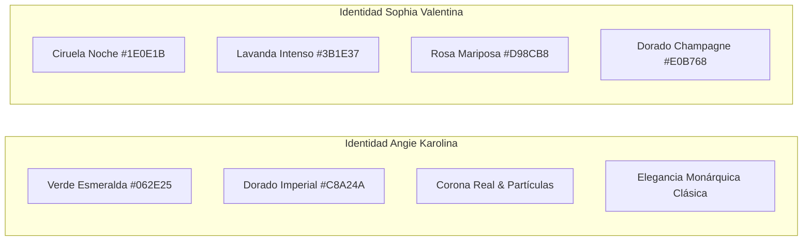

# 08 — AUDITORÍA VISUAL Y EXPERIENCIA DE USUARIO (UX/UI)
**Plataforma:** XV Experience  
**Fecha:** 25 de Noviembre de 2026  
**Especialidad:** Diseño UX/UI Senior especializado en Experiencias Digitales Premium

---

## 1. EVALUACIÓN ESTÉTICA Y DE MARCA PREMIUM

La plataforma ofrece una experiencia visual de alta gama orientada al mercado de celebraciones de 15 años. El diseño recrea la sensación de una invitación de gala con toques interactivos cinemáticos.

---

## 2. EVALUACIÓN COMPARATIVA: ¿SOPHIA TIENE IDENTIDAD PROPIA?

### Diagnóstico: **SÍ, POSEE IDENTIDAD PROPIA CLARAMENTE DIFERENCIADA**
No se limitó a cambiar el color de fondo. La experiencia de Sophia Valentina incorpora una transformación visual profunda:
1. **Paleta Cromática Armonizada:** La combinación de ciruela noche (`#1E0E1B`), lavanda profundo (`#3B1E37`), rosa mariposa (`#D98CB8`) y dorado champagne (`#E0B768`) reemplaza por completo el esquema verde esmeralda. Los bordes de las tarjetas, brillos de botones, badges de VIP y textos dorados toman la tonalidad champagne suave.
2. **Retrato Editorial de Alta Resolución:** Se incorporó el retrato oficial de quinceañera en [sophia-portada.jpg](file:///c:/Users/troni/Documents/Descarga-Antigravity/InvitacionAngie/sophia-portada.jpg) (913 KB) con vestido rosa blush, tiara champagne y ornamentos de mariposas, eliminando el marco vacío o roto que existía anteriormente.
3. **Música Coherente:** El tema *Princesa Sofía* acompaña la navegación de las 13 tarjetas reforzando la atmósfera de cuento de hadas floral.
4. **Pase VIP Exclusivo:** Los boletos de asistencia de Sophia generan credenciales VIP doradas con el título *Sophia Valentina · Mis XV Años* y QR personalizado.

### Elementos que aún requieren personalización visual en Sophia:
- **Corona en Arco Superior:** El arco dorado sobre la fotografía de portada sigue mostrando una corona monárquica clásica en lugar de una mariposa o tiara estilizada de mariposas en SVG.
- **Partículas de Fondo:** Las partículas flotantes en el fondo siguen usando la animación de destellos dorados estándar; podrían incorporarse mariposas tenues flotando con trayectoria bezier.

---

## 3. AUDITORÍA DE NAVEGACIÓN Y USABILIDAD MOBILE-FIRST
- **Formato Tarjetas Táctiles (Deck Layout):** Navegación horizontal swipe con indicadores paginados en la parte inferior. Muy natural e intuitiva en smartphones.
- **Tipografías y Legibilidad:**
  - Títulos principales en *Playfair Display* y *Great Vibes*: Elegantes y proporcionadas.
  - Textos de lectura en *Montserrat* (14px - 16px): Excelente contraste contra los fondos oscuros (cumple estándar WCAG AAA de contraste superior a 7:1).
- **Formularios Táctiles:** El formulario de confirmación RSVP y el de subida móvil por QR cuentan con inputs de altura táctil adecuada (48px - 54px), facilitando el tipeo sin errores con una sola mano.

---

## 4. ESTADO DE IMÁGENES Y APROBACIÓN DE CLIENTES
- **Angie Karolina:** 100% de fotografías reales y oficiales aprobadas por la familia.
- **Sophia Valentina:** 
  - La imagen actual [sophia-portada.jpg](file:///c:/Users/troni/Documents/Descarga-Antigravity/InvitacionAngie/sophia-portada.jpg) es un **retrato editorial de alta resolución generado artísticamente como propuesta conceptual para producción**.
  - **Estado:** Requiere validación o reemplazo final por las fotografías de la sesión oficial de estudio de Sophia Valentina Rivas Sánchez cuando sus padres las entreguen.
