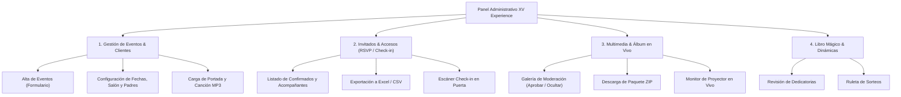

# 09 — AUDITORÍA DEL PANEL ADMINISTRATIVO
**Plataforma:** XV Experience  
**Fecha:** 25 de Noviembre de 2026  
**Especialidad:** Full Stack Senior y Product Management

---

## 1. ESTADO ACTUAL DEL PANEL ([admin/index.php](file:///c:/Users/troni/Documents/Descarga-Antigravity/InvitacionAngie/admin/index.php))
El panel administrativo es un **archivo monolítico de 2,018 líneas (105 KB)** que combina autenticación, consultas SQL directas, controladores de acción y vistas HTML con Tailwind/CSS embebido.

Está protegido por contraseña (`ADMIN_PASS`, por defecto `angie2026` / `sophia2026` / `admin2026`) y maneja sesiones PHP nativas con control de rol (`superadmin`, `anfitrion`).

---

## 2. CAPACIDADES ACTUALES VS LIMITACIONES

| Capacidad Requerida | ¿Disponible en el Panel Actual? | Detalle Técnico / Ubicación |
| :--- | :---: | :--- |
| **Cambio de Celebración Activa** | **SÍ** | Selector superior que actualiza `$_SESSION['active_evento_id']`. |
| **Crear Nueva Celebración** | **NO** | No existe interfaz web para crear eventos; requiere SQL manual. |
| **Editar Datos de la Celebración** | **NO** | No hay formularios para editar fecha, salón o nombres de padres. |
| **Gestionar Invitados Confirmados**| **SÍ** | Tabla completa con nombres, acompañantes, pases y fechas de registro. |
| **Exportar Invitados a CSV** | **SÍ** | Endpoint `?export=csv` filtra por el evento activo. |
| **Control de Entrada y Check-in** | **SÍ** | Modal con escáner de cámara HTML5 y búsqueda manual por código. |
| **Ruleta de Premios / Rifa** | **SÍ** | Ruleta interactiva animada con confetti para los boletos del evento. |
| **Moderar / Ocultar Fotos QR** | **SÍ** | Botón para conmutar `visible = 0/1` sobre las fotos enviadas. |
| **Descarga Masiva de Fotos en ZIP** | **SÍ** | Endpoint `?export=fotos_zip` empaqueta las fotos del evento activo. |
| **Eliminación Física de Fotos** | **SÍ** | Elimina registro de `fotos_fiesta` y ejecuta `unlink()` en disco. |
| **Moderar Dedicatorias del Libro** | **PARCIAL** | Permite visualizar dedicatorias, pero la edición es limitada. |
| **Carga Web de Música y Covers** | **NO** | No hay cargador multimedia en el panel administrativo. |

---

## 3. PROPUESTA DE REESTRUCTURACIÓN DEL PANEL INTERNO

Para facilitar el trabajo del operador de Kick-Off, se propone reorganizar el panel en **4 módulos claros**:

