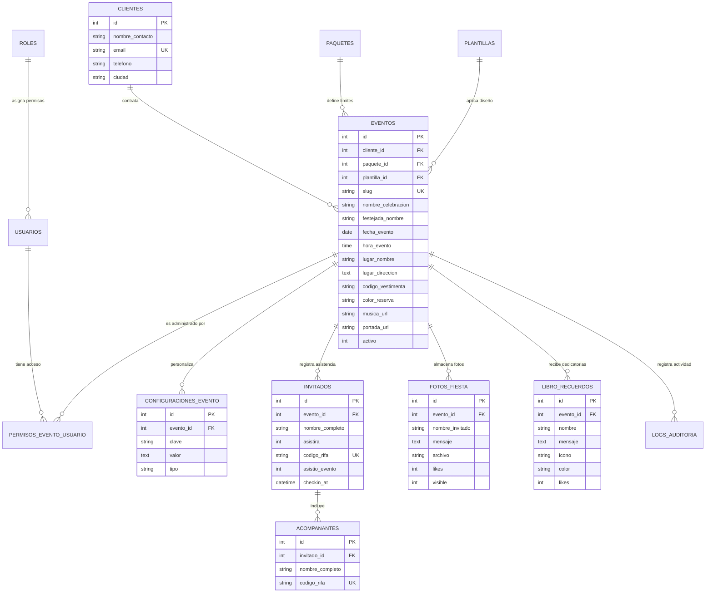

# 10 — AUDITORÍA DE BASE DE DATOS Y MODELO RELACIONAL
**Plataforma:** XV Experience  
**Fecha:** 25 de Noviembre de 2026  
**Especialidad:** Especialista en Bases de Datos y Arquitectura de Software

---

## 1. INVENTARIO DE TABLAS ACTIVAS EN SQLITE (`database/invitacion_xv.sqlite`)

La base de datos SQLite activa cuenta con **14 tablas** y un peso físico de **159 KB**:

| Tabla | Registros Reales | Clave Primaria | Clave Foránea / Discriminador | Función en el Sistema |
| :--- | :---: | :---: | :--- | :--- |
| **`eventos`** | **2** | `id` | `cliente_id`, `paquete_id`, `plantilla_id` | Almacén maestro de celebraciones (Angie y Sophia). |
| **`configuraciones_evento`**| **32** | `id` | `evento_id` (Índice único con `clave`) | Diccionario clave-valor para tokens CSS, itinerario y trivia. |
| **`clientes`** | **2** | `id` | Ninguna | Familias contratantes (Familia Avendaño y Familia Rivas). |
| **`paquetes`** | **3** | `id` | Ninguna | Planes comerciales (Royal Diamond, Crystal, Emerald). |
| **`plantillas`** | **2** | `id` | Ninguna | Diseños base (Esmeralda Prestige, Rose Gold Princess). |
| **`roles`** | **3** | `id` | Ninguna | Niveles de permiso (superadmin, anfitrion, staff). |
| **`usuarios`** | **3** | `id` | `rol_id` | Cuentas administrativas con contraseña bcrypt. |
| **`permisos_evento_usuario`**| **2** | `id` | `usuario_id`, `evento_id` | Asignación de anfitriones a celebraciones específicas. |
| **`invitados`** | **0** | `id` | `evento_id` | Invitados titulares confirmados vía formulario RSVP. |
| **`acompanantes`** | **0** | `id` | `invitado_id` | Acompañantes adicionales vinculados a un titular. |
| **`fotos_fiesta`** | **160** | `id` | `evento_id` | Galería oficial de fiesta y fotos enviadas por QR. |
| **`canciones`** | **0** | `id` | Ninguna *(Pendiente agregar `evento_id`)* | Sugerencias musicales de los invitados. |
| **`libro_recuerdos`** | **6** | `id` | `evento_id` | Dedicatorias interactivas del libro mágico. |
| **`logs_auditoria`** | **0** | `id` | `evento_id`, `usuario_id` | Registro de eventos y accesos administrativos. |

---

## 2. DIAGRAMA ENTIDAD-RELACIÓN ACTUAL (MERMAID)

---

## 3. EVALUACIÓN DE LA CONEXIÓN DUAL Y RIESGO DE DISPARIDAD

### ¿Cómo funciona la conexión dual?
En [config/database.php](file:///c:/Users/troni/Documents/Descarga-Antigravity/InvitacionAngie/config/database.php) y [app/Core/Database.php](file:///c:/Users/troni/Documents/Descarga-Antigravity/InvitacionAngie/app/Core/Database.php):
1. Si existe la variable de entorno `DB_CONNECTION=sqlite`, se conecta de forma inmediata a `database/invitacion_xv.sqlite`.
2. Si no existe o está en `auto`, intenta conectarse sucesivamente a MySQL en `127.0.0.1`, `mysql`, `mariadb`, `database`, `db`.
3. Si los servidores MySQL no responden (o agotan el tiempo de conexión), se activa el fallback a SQLite.

### Riesgos Identificados:
- **Riesgo de Escritura Dividida (Split-Brain Database):** Si en un entorno local o de staging una parte del código lograra conectar a un MySQL local y otra parte cayera en SQLite, los invitados o fotos se guardarían en bases de datos diferentes.
- **Mitigación Recomendada:** Definir explícitamente en el archivo `.env` o en las variables de Easypanel `DB_CONNECTION=sqlite` (para desarrollo/MVP) o `DB_CONNECTION=mysql` (para producción con MariaDB administrada), desactivando el modo de conmutación automática en caliente.
