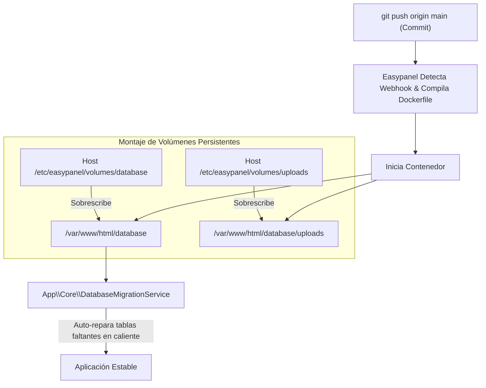

# 13 — AUDITORÍA DE INFRAESTRUCTURA, DESPLIEGUE Y DEVOPS
**Plataforma:** XV Experience  
**Fecha:** 25 de Noviembre de 2026  
**Especialidad:** Ingeniero DevOps Senior y Cloud Infrastructure

---

## 1. EVALUACIÓN DE ARQUITECTURA DE CONTENEDORES (DOCKER)

### 1.1 Análisis del [Dockerfile](file:///c:/Users/troni/Documents/Descarga-Antigravity/InvitacionAngie/Dockerfile)
```dockerfile
FROM php:8.2-apache
RUN apt-get update && apt-get install -y --no-install-recommends libsqlite3-dev \
    && docker-php-ext-install pdo pdo_mysql pdo_sqlite \
    && apt-get clean && rm -rf /var/lib/apt/lists/*
RUN a2enmod rewrite headers
RUN sed -ri -e 's!AllowOverride None!AllowOverride All!g' /etc/apache2/apache2.conf
COPY . /var/www/html/
RUN mkdir -p /var/www/html/database && chown -R www-data:www-data /var/www/html && chmod -R 775 /var/www/html/database
EXPOSE 80
CMD ["apache2-foreground"]
```

### 1.2 Puntos Fuertes de la Imagen
1. **Ligera y Específica:** Basada en la imagen oficial Debian `php:8.2-apache`.
2. **Control de Apache:** Activa `rewrite` y `headers`, habilitando el enrutamiento limpio del Front Controller y el bloqueo de archivos sensibles mediante `.htaccess`.
3. **Soporte Dual de Base de Datos:** Compila las extensiones nativas `pdo_mysql` y `pdo_sqlite`.

---

## 2. EVALUACIÓN DE PERSISTENCIA EN EASYPANEL Y RIESGO DE PÉRDIDA DE DATOS

### ¿Qué sucede durante un despliegue en Easypanel?
En Easypanel, cada despliegue reconstruye la imagen Docker o reinicia el contenedor con la nueva versión del código de GitHub.



### Diagnóstico de Persistencia:
1. **Fotografías y Uploads:** **PERSISTEN.** Las imágenes subidas por los invitados se guardan en `database/uploads/fotos/`, carpeta que está montada sobre volumen persistente en el servidor de Easypanel.
2. **Registros de Base de Datos:** **PERSISTEN.** El archivo `invitacion_xv.sqlite` reside dentro del volumen montado.
3. **Resiliencia ante Desincronización de Esquemas:** Anteriormente, si el volumen montado tenía una base de datos antigua sin la tabla `eventos`, la aplicación arrojaba un error fatal. Con la incorporación de [DatabaseMigrationService.php](file:///c:/Users/troni/Documents/Descarga-Antigravity/InvitacionAngie/app/Core/DatabaseMigrationService.php), el sistema se auto-repara en caliente en el primer arranque, eliminando el riesgo de caída de servicio tras un despliegue.

---

## 3. SEPARACIÓN DE ENTORNOS (DESARROLLO VS PRODUCCIÓN)
- **Estado Actual:** No existe canal formal de staging. Tanto el desarrollo local como la instancia en Easypanel comparten el mismo repositorio de GitHub en la rama `main`.
- **Riesgo:** Un commit con error introducido en la rama principal se despliega de inmediato a la URL pública de producción (`kickoff-invitacionangie.0gxuxx.easypanel.host`).
- **Recomendación DevOps:**
  - Crear rama `develop` para pruebas de integración.
  - Reservar rama `main` exclusivamente para versiones estables con tag de versión (v1.0, v1.1).
  - Configurar pipeline de GitHub Actions para correr la suite de pruebas `tests/suite_runner.php` antes de permitir un merge a `main`.
