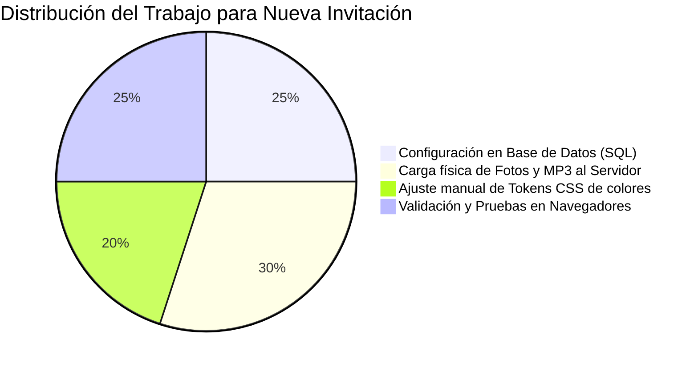

# 14 — AUDITORÍA DE VIABILIDAD COMERCIAL Y ESCALABILIDAD
**Plataforma:** XV Experience  
**Fecha:** 25 de Noviembre de 2026  
**Especialidad:** Product Manager Senior y Arquitecto de Software

---

## 1. ESCENARIOS DE ESCALABILIDAD COMERCIAL (5, 20, 50 Y 100 CELEBRACIONES)

La plataforma fue evaluada bajo 4 escenarios hipotéticos de demanda comercial:

| Escenario | Viabilidad Actual | Limitaciones Críticas Encontradas | Acciones Necesarias para Soportarlo |
| :---: | :---: | :--- | :--- |
| **5 Celebraciones** | **ALTA (100% Viable)** | Requiere carga manual de fotos y MP3 al servidor por parte del equipo técnico. | Configurar registros en `eventos` y subir assets a `storage/media/{id}/`. |
| **20 Celebraciones** | **MEDIA (70% Viable)** | `admin/index.php` tiene un selector de celebraciones plano en un dropdown; con 20 eventos se vuelve engorroso. `api/invitados.php` mezclaría listas si no se corrige. | Blindar endpoints de API con `evento_id` y añadir paginación en el panel administrativo. |
| **50 Celebraciones** | **BAJA (35% Viable)** | Base de datos SQLite única compartida. Con 50 fiestas simultáneas de fin de semana subiendo fotos al proyector, los bloqueos de escritura (`database is locked`) degradarán el servicio. | Migrar a MariaDB / MySQL administrada en Easypanel con pool de conexiones. |
| **100 Celebraciones** | **INVIABLE sin rediseño** | Monolito de vistas, archivos en raíz, ausencia de autoservicio para clientes, saturación de almacenamiento local en un solo contenedor Docker. | Migración completa a Laravel 11, almacenamiento de imágenes en S3 / Cloudflare R2 y panel Filament. |

---

## 2. TRABAJO MANUAL ACTUAL POR CADA NUEVA INVITACIÓN VENDIDA

- **Tiempo estimado por invitación:** **45 a 90 minutos de trabajo técnico especializado** por cada celebración que contrate el servicio.
- **Razón:** El operador no puede simplemente llenar un formulario en un panel y pulsar "Guardar". Debe:
  1. Insertar el cliente y el evento en la base de datos SQLite.
  2. Subir la fotografía de portada y el archivo de música a las rutas exactas.
  3. Codificar el JSON de colores, el itinerario y la trivia.
  4. Realizar commit a Git o subir por FTP/SSH al servidor.

---

## 3. COMPONENTES FALTANTES PARA LA COMERCIALIZACIÓN TOTAL

### Imprescindibles para la Entrega Oficial de Sophia Valentina:
1. Reemplazo del retrato conceptual de Sophia por sus fotografías definitivas de sesión de estudio (cuando sus padres las entreguen).
2. Incorporación de la dirección física oficial y enlace de Google Maps del Salón Nova Roma (actualmente en "Dirección pendiente").
3. Corrección del regex de validación en `api/checkin.php` para que el personal de puerta pueda escanear pases `XVSOPHIA-...`.

### Diferibles para la Versión 2.0 (SaaS):
1. Registro y login de clientes autoservicio (los padres de quinceañeras prefieren hoy un servicio "llave en mano" atendido por Kick-Off).
2. Pasarela de pagos automatizada con Stripe / Pagos locales (la cobranza se gestiona manualmente por contrato de evento).
3. Personalización visual drag-and-drop.
