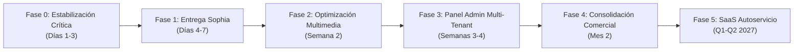

# 16. PLAN DE CONTINUIDAD Y HOJA DE RUTA — XV EXPERIENCE

**Documento:** 16 de 18  
**Fecha:** 25 de noviembre de 2026  
**Equipo Auditor:** Arquitectura, Full Stack, DevOps, Seguridad, UX/UI, QA y Product Management  
**Proyecto:** XV Experience (Kick-Off Development)

---

## 1. INTRODUCCIÓN Y ENFOQUE ESTRATÉGICO

El presente plan de continuidad traza la ruta técnica, operativa y comercial para consolidar **XV Experience** como una plataforma SaaS multi-celebración de alto impacto y rentabilidad. Tras la auditoría integral, se establece un plan dividido en **6 fases secuenciales (Fases 0 a 5)** estructuradas para eliminar riesgos críticos inmediatos, garantizar la entrega impecable de Sophia Valentina, optimizar la experiencia colaborativa y sentar las bases de la expansión comercial sin interrupciones operativas.



---

## 2. DESGLOSE DE FASES DE CONTINUIDAD

### FASE 0: ESTABILIZACIÓN CRÍTICA E INMEDIATA (Días 1 a 3)
*Objetivo:* Subsanar de forma prioritaria los 4 vectores de fuga de datos multi-tenant identificados en los endpoints API sin alterar la interfaz gráfica ni la experiencia de Angie.

| ID | Tarea / Acción Técnica | Endpoint / Componente Afectado | Responsable | Estimación | Criterio de Aceptación (DoD) |
|---|---|---|---|---|---|
| **F0.1** | Incorporar filtro obligatorio `evento_id = ?` en la consulta de invitados | `api/invitados.php` | Backend Developer | 2 h | Consulta GET filtra por tenant activo; ninguna petición expone invitados de otra celebración. |
| **F0.2** | Generalizar expresión regular de código de check-in para soportar cualquier slug/prefijo | `api/checkin.php` | Backend Developer | 3 h | El validador acepta códigos dinámicos por evento (`XVSOPHIA-XXX`, `XVANGIE-XXX`, etc.) vinculados al `evento_id`. |
| **F0.3** | Desacoplar videos y mensajes de agradecimiento fijos de Angie en el libro de recuerdos | `api/libro.php` | Backend Developer | 2 h | Si el evento activo no tiene videos cargados, retorna array vacío `[]` y mensaje genérico configurable por BD. |
| **F0.4** | Agregar columna `evento_id` a la tabla `canciones_pedidas` | `api/canciones.php`, Migración | DB / Backend | 2 h | Las sugerencias musicales de los invitados se guardan y consultan estrictamente por celebración. |
| **F0.5** | Implementar Rate Limiting básico por IP en subida de fotos y mensajes del libro | `api/fotos.php`, `api/libro.php` | DevOps / Backend | 4 h | Máximo 10 peticiones/minuto por IP para prevenir saturación intencional o accidental. |

---

### FASE 1: COMPLETITUD Y ENTREGA DE SOPHIA VALENTINA (Días 4 a 7)
*Objetivo:* Dejar la celebración `/e/sophia-xv` al 100% de calidad visual, fotográfica y funcional para su aprobación y uso oficial por la familia Rivas Sánchez.

| ID | Tarea / Acción Técnica | Componente Afectado | Responsable | Estimación | Criterio de Aceptación (DoD) |
|---|---|---|---|---|---|
| **F1.1** | Confirmación y parametrización de la dirección física de Salón Nova Roma | `config/celebraciones/sophia-xv.json`, BD | PM / Operaciones | 1 h | Dirección validada en Google Maps y Waze; enlaces dinámicos generados correctamente. |
| **F1.2** | Carga de fotografías de estudio y sesión oficial de Sophia | `/assets/img/sophia/`, BD `galeria` | UX / Multimedia | 4 h | Al menos 8-12 fotografías de alta calidad integradas en la galería fotográfica de Sophia sin fotos vacías. |
| **F1.3** | Generación de retrato oficial de portada y optimización WebP | `/assets/img/sophia-portada.webp` | Diseñador UX | 2 h | Imagen de portada de alta fidelidad, optimizada a menos de 350 KB, armonizada con el marco dorado. |
| **F1.4** | Validación de archivo de audio oficial (*Princesa Sofía*) | `/assets/audio/sophia.mp3`, `.m4a` | Multimedia | 1 h | Archivo optimizado con bitrate adecuado (128 kbps), compatible con reproducción fluida en Safari y Android. |
| **F1.5** | Prueba integral de usuario con la familia y simulación de 10 RSVPs | Flujo completo `/e/sophia-xv` | QA Specialist | 4 h | Confirmaciones, libro de recuerdos y subida de fotos verificados en dispositivos reales (iPhone y Android). |

---

### FASE 2: ROBUSTECIMIENTO Y OPTIMIZACIÓN MULTIMEDIA (Semana 2)
*Objetivo:* Resolver el cuello de botella del ancho de banda y la experiencia de subida en eventos en vivo con alta concurrencia.

| ID | Tarea / Acción Técnica | Componente Afectado | Responsable | Estimación | Criterio de Aceptación (DoD) |
|---|---|---|---|---|---|
| **F2.1** | Implementar compresión de imágenes en el cliente vía Canvas/WebP antes de subir | `public/subir-fotos.php` | Frontend Developer | 6 h | Fotos tomadas con cámaras de 48-108 MP (15-25 MB) se comprimen en el navegador móvil a ~800 KB antes de enviarse. |
| **F2.2** | Integrar procesamiento asíncrono o generación de miniaturas WebP en servidor | `api/fotos.php` | Backend Developer | 5 h | Generación automática de thumbnail (`thumb_*.webp`) para carga ultra veloz de galerías y pantalla en vivo. |
| **F2.3** | Activación de compresión GZIP/Brotli y cabeceras de caché estática en Apache | `.htaccess`, `Dockerfile` | DevOps Specialist | 3 h | Assets estáticos (JS, CSS, fuentes, audios) devuelven cabeceras `Cache-Control: public, max-age=31536000`. |
| **F2.4** | Integrar CDN gratuita vía Cloudflare (DNS Proxy) | Infraestructura DNS | DevOps Specialist | 2 h | Todo el tráfico estático y multimedia es cacheado en edge servers, reduciendo en un 70% la carga sobre Easypanel. |

---

### FASE 3: PANEL ADMINISTRATIVO MULTI-TENANT OPERATIVO (Semanas 3 a 4)
*Objetivo:* Permitir que el equipo de Kick-Off Development gestione eventos, configuraciones y galerías desde el panel web sin tocar archivos JSON ni base de datos manualmente.

| ID | Tarea / Acción Técnica | Componente Afectado | Responsable | Estimación | Criterio de Aceptación (DoD) |
|---|---|---|---|---|---|
| **F3.1** | Implementar selector de evento activo persistente en sesión de administrador | `admin/index.php` | Full Stack | 6 h | Selector dropdown en la barra superior del admin; filtra automáticamente dashboard, fotos, RSVPs e invitados. |
| **F3.2** | Módulo CRUD de eventos (Crear, Editar, Activar/Desactivar celebraciones) | `admin/eventos.php` | Full Stack | 10 h | Permite crear un evento nuevo en 5 minutos ingresando nombre, slug, fecha, colores y textos sin tocar código. |
| **F3.3** | Gestor multimedia multi-evento (subida de portada, audio y fotos oficiales) | `admin/multimedia.php` | Full Stack | 8 h | Sube archivos directamente a la carpeta del evento y actualiza rutas en BD de forma automática. |
| **F3.4** | Moderación de fotos en vivo (Aprobar / Ocultar fotos del álbum colaborativo) | `admin/fotos.php`, `api/fotos.php` | Full Stack | 6 h | Filtro `aprobada = 1` opcional para que fotos inapropiadas no salgan automáticamente a la pantalla gigante. |
| **F3.5** | Exportación de reportes de asistencia en Excel/CSV por celebración | `admin/exportar.php` | Backend Developer | 4 h | Descarga lista de invitados confirmados, pases asignados y requerimientos especiales en un clic. |

---

### FASE 4: CONSOLIDACIÓN COMERCIAL Y OPERATIVA INTERNA (Mes 2)
*Objetivo:* Establecer el proceso de venta, empaquetado, diseño y entrega de invitaciones digitales para clientes reales de Kick-Off Development.

| ID | Tarea / Acción Técnica | Componente Afectado | Responsable | Estimación | Criterio de Aceptación (DoD) |
|---|---|---|---|---|---|
| **F4.1** | Catálogo de 5 temas visuales prediseñados (Tokens CSS) | Motor de Temas / CSS | UX/UI Designer | 12 h | Temas: Esmeralda Real, Rosa Princesa, Azul Medianoche, Violeta Encantado, Minimalista Dorado. |
| **F4.2** | Automatización de enlaces personalizados para WhatsApp | `app/Services/WhatsAppLinkGenerator.php` | Backend Developer | 6 h | Generador de mensajes personalizados por invitado con su enlace único de pase VIP (`/e/slug?i=token`). |
| **F4.3** | Manual de onboarding operativo para el equipo Kick-Off | Documentación Operativa | Product Manager | 6 h | Guía paso a paso para dar de alta una nueva quinceañera en menos de 90 minutos. |
| **F4.4** | Paquetes comerciales y contratos de servicio (Plata, Oro, Diamante) | Propuesta Comercial | Product Manager | 8 h | Definición formal de entregables, precios, límites de fotos e inclusión de pantalla en vivo. |

---

### FASE 5: EVOLUCIÓN ESTRATÉGICA HACIA SAAS AUTOSERVICIO (Q1-Q2 2027)
*Objetivo:* Migración progresiva y estructurada hacia una plataforma SaaS escalable con panel de autoservicio para familias y organizadores.

| ID | Tarea / Acción Técnica | Componente Afectado | Responsable | Estimación | Criterio de Aceptación (DoD) |
|---|---|---|---|---|---|
| **F5.1** | Evaluación formal y Proof of Concept en Laravel 11 + Filament 3 | Repositorio satélite / PoC | Arquitecto de Software | 2 sprints | Benchmark de consumo de recursos y facilidad de mantenimiento vs stack actual. |
| **F5.2** | Migración definitiva del almacenamiento local a Amazon S3 o Cloudflare R2 | `StorageService` | DevOps Specialist | 1 sprint | Multimedia desacoplada del contenedor Docker, costo de almacenamiento inferior a $0.015/GB/mes. |
| **F5.3** | Integración de pasarelas de pago (Stripe / Mercado Pago / PagoMóvil) | Módulo de Facturación | Backend Developer | 2 sprints | Cobro automatizado de suscripciones y pagos únicos por celebración. |
| **F5.4** | Portal de autoservicio para padres y quinceañeras | Frontend / Portal Cliente | Full Stack / UX | 3 sprints | El cliente puede editar su lista de invitados y moderar sus fotos de forma autónoma con rol restringido. |

---

## 3. ASIGNACIÓN DE ROLES Y RESPONSABILIDADES

```
+--------------------------------------------------------------------------------+
|                         MATRIZ RACI DEL PROYECTO                               |
+--------------------------------------------------------------------------------+
| Rol                         | Responsabilidad Principal                        |
+-----------------------------+--------------------------------------------------+
| Arquitecto de Software      | Definición de estándares, aislamiento y PoC      |
| Desarrollador Backend       | Endpoints API, lógica multi-tenant, seguridad    |
| Desarrollador Frontend      | Optimización JS/Canvas, diseño adaptativo, UX    |
| Diseñador UX/UI             | Identidades visuales, tokens de color, portadas  |
| DevOps Specialist           | Easypanel, Docker, Dockerfiles, Cloudflare CDN   |
| QA Specialist               | Pruebas de regresión, matriz E2E, dispositivos   |
| Product Manager             | Roadmap, requerimientos con clientes, paquetes   |
+--------------------------------------------------------------------------------+
```

---

## 4. DEFINICIÓN DE TERMINADO (DEFINITION OF DONE - DoD)

Para considerar formalmente cerrada cualquier fase o tarea técnica, se deben cumplir obligatoriamente los siguientes 5 puntos:

1. **Aislamiento Multi-Tenant Certificado:** La funcionalidad ha sido ejecutada en Angie (`/e/angie-xv`) y Sophia (`/e/sophia-xv`) sin filtración cruzada de datos, parámetros o assets.
2. **Compatibilidad Móvil:** Verificada en resolución viewport móvil (360x640 hasta 430x932) en Safari iOS y Chrome Android.
3. **Cero Regresiones en Angie:** La invitación de Angie Karolina mantiene al 100% sus 19 videos, 160 fotos, música y estilo original.
4. **Resiliencia de Base de Datos:** Si la base de datos se reinicia o se conecta una nueva instancia, `DatabaseMigrationService` inicializa el esquema sin errores `HY000`.
5. **Documentación Actualizada:** Registro del cambio en el repositorio y actualización de la documentación operativa.
