# 18. REGISTRO DE DECISIONES PENDIENTES — XV EXPERIENCE

**Documento:** 18 de 18  
**Fecha:** 25 de noviembre de 2026  
**Equipo Auditor:** Arquitectura, Dirección Técnica, Product Management y Operaciones  
**Proyecto:** XV Experience (Kick-Off Development)

---

## 1. INTRODUCCIÓN

Este documento consolida las **8 decisiones estratégicas, técnicas, de producto y operativas** que requieren resolución y aprobación expresa por parte del liderazgo de **Kick-Off Development** para guiar las siguientes fases de desarrollo, inversión y comercialización de la plataforma **XV Experience**.

Cada decisión se presenta con su contexto, opciones disponibles, análisis de impacto y la recomendación fundamentada del equipo multidisciplinario de auditoría.

---

## 2. MATRIZ DE DECISIONES ESTRATÉGICAS

```mermaid
flowchart TD
    D1["D1: ¿Reescribir a Laravel o Consolidar PHP Actual?"]
    D2["D2: ¿SQLite o MariaDB en Producción?"]
    D3["D3: ¿Modelo Operado o Autoservicio Inmediato?"]
    D4["D4: Aprobación de Sesión Fotográfica de Sophia"]
    D5["D5: Confirmación de Dirección de Salón Nova Roma"]
    D6["D6: ¿Almacenamiento Local o S3 / Cloudflare R2?"]
    D7["D7: ¿Moderación Previa de Fotos o Filtro Directo?"]
    D8["D8: Definición de Paquetes y Precios Comerciales"]
```

---

### DECISIÓN 1: EVOLUCIÓN ARQUITECTÓNICA (¿LARAVEL 11 O CONSOLIDACIÓN PHP ACTUAL?)
*Área:* Arquitectura de Software  
*Impacto:* Muy Alto (Tiempo a mercado, costos de desarrollo, rendimiento)

- **Contexto:** En auditorías preliminares se sugirió migrar la aplicación a Laravel 11, Blade y Filament. Sin embargo, el motor actual en PHP 8.2 modular con `Router` y `TenantResolverMiddleware` responde en menos de 45 ms y consume solo 28 MB de RAM.
- **Opciones:**
  - **Opción A (Reescritura completa a Laravel 11):** Congelar ventas durante 6-8 semanas para reescribir modelos, controladores, autenticación y vistas Blade. Requiere mayor consumo de RAM en Easypanel (~150 MB por contenedor) y Composer.
  - **Opción B (Consolidación y perfeccionamiento del motor actual - RECOMENDADA):** Mantener el núcleo ágil en PHP 8.2, modularizar `public/index.php` en componentes limpios, enriquecer el panel administrativo actual y posponer la migración a Laravel para la Fase 5 (cuando exista volumen de clientes que justifique el costo).
- **Recomendación del Equipo:** **Opción B.** Permite lanzar comercialmente Sophia en 3 días y captar ingresos de inmediato sin asumir semanas de costo improductivo de reescritura.

---

### DECISIÓN 2: MOTOR DE BASE DE DATOS PARA PRODUCCIÓN EN EASYPANEL
*Área:* Infraestructura y DevOps  
*Impacto:* Alto (Concurrencia de eventos, concurrencia de escrituras)

- **Contexto:** Actualmente se utiliza SQLite en `/var/www/html/database/invitacion_xv.sqlite` montado en un volumen persistente de Docker. Cuenta con soporte nativo dual implementado para conectarse a MariaDB si se configuran variables de entorno.
- **Opciones:**
  - **Opción A (Mantener SQLite en volumen Docker):** Ventajas: portabilidad total, cero costo adicional de servidor, respaldos copiando un solo archivo. Limitación: bloqueo de escrituras simultáneas si coinciden más de 30 subidas de fotos por segundo en el mismo instante.
  - **Opción B (Migrar a servicio MariaDB gestionado en Easypanel - RECOMENDADA):** Desplegar un contenedor oficial de MariaDB en Easypanel vinculado al contenedor web mediante `DB_CONNECTION=mysql`.
- **Recomendación del Equipo:** **Opción B.** Implementar MariaDB antes de atender más de 2 eventos masivos en simultáneo, garantizando concurrencia total en subidas de fotos por QR y confirmaciones masivas.

---

### DECISIÓN 3: MODELO OPERATIVO Y COMERCIAL INMEDIATO
*Área:* Negocio y Product Management  
*Impacto:* Alto (Diseño de interfaz, seguridad de permisos)

- **Contexto:** Se debate si la plataforma debe ofrecer registro público para que cualquier persona cree su invitación (SaaS Autoservicio) o si Kick-Off Development comercializa el servicio como agencia de desarrollo premium ("Done-For-You").
- **Opciones:**
  - **Opción A (Autoservicio Inmediato):** Desarrollar registro público, pasarelas de pago automatizadas y asistentes de configuración. Requiere alta inversión en seguridad, soporte al usuario final y gestión de quejas.
  - **Opción B (Servicio Administrado Premium por Kick-Off - RECOMENDADA):** Kick-Off vende el servicio a familias y planificadores de bodas/XV años. El equipo interno carga las fotos, personaliza la paleta y entrega el enlace listo en 24 horas con garantía VIP.
- **Recomendación del Equipo:** **Opción B.** Maximiza el ticket promedio por cliente ($80 - $250 USD por evento) y asegura un estándar de calidad visual impecable mientras la plataforma madura.

---

### DECISIÓN 4: MATERIAL GRÁFICO Y FOTOGRÁFICO DEFINITIVO DE SOPHIA VALENTINA
*Área:* UX/UI y Operaciones de Contenido  
*Impacto:* Medio (Calidad visual de la celebración de referencia)

- **Contexto:** Actualmente `/e/sophia-xv` cuenta con un retrato provisional generado para la portada. La galería fotográfica oficial tiene 0 fotografías registradas, mientras que Angie cuenta con 160 fotografías profesionales de estudio.
- **Acción Requerida:** Solicitar formalmente a la familia Rivas Sánchez (o al fotógrafo asignado) el paquete de 8 a 15 fotografías de estudio en alta resolución para poblar la galería y sustituir la portada provisional antes del lanzamiento formal.
- **Plazo Límite de Aprobación:** 48 horas tras el cierre de esta auditoría.

---

### DECISIÓN 5: CONFIRMACIÓN LOGÍSTICA DE SALÓN NOVA ROMA
*Área:* Información y Datos del Evento  
*Impacto:* Medio (Utilidad de navegación para invitados)

- **Contexto:** El campo de ubicación tiene asignado `"Salón Nova Roma"` y la dirección figura como `"pendiente de confirmación"`. Los botones de Google Maps y Waze requieren coordenadas o dirección física completa para guiar a los invitados el día del evento (21 de diciembre de 2026).
- **Acción Requerida:** Confirmar dirección exacta (calle, sector, ciudad) y coordenadas GPS con la familia para actualizar la base de datos y habilitar los enlaces de navegación interactivos.

---

### DECISIÓN 6: ALMACENAMIENTO MULTIMEDIA EN LA NUBE (¿LOCAL O CLOUDFLARE R2?)
*Área:* DevOps e Infraestructura  
*Impacto:* Medio-Alto (Capacidad de disco del servidor, velocidad de carga)

- **Contexto:** Las fotos del álbum colaborativo por QR se almacenan directamente en el disco del contenedor Docker (`/public/uploads/`). Un evento con 150 invitados subiendo fotos puede generar fácilmente entre 2 GB y 6 GB de almacenamiento.
- **Opciones:**
  - **Opción A (Almacenamiento Local con Limpieza Periódica):** Mantener en disco y descargar un ZIP al terminar la fiesta. Requiere monitorear el espacio del disco del VPS de Easypanel.
  - **Opción B (Cloudflare R2 / S3 Compatible - RECOMENDADA a mediano plazo):** Conectar un bucket de Cloudflare R2 sin costo de salida de datos (egress gratuito) y almacenamiento a costo ínfimo ($0.015/GB/mes).
- **Recomendación del Equipo:** Mantener local para los dos primeros eventos y activar Cloudflare R2 en la Fase 2 (Semana 2).

---

### DECISIÓN 7: POLÍTICA DE MODERACIÓN DEL ÁLBUM COLABORATIVO EN VIVO
*Área:* Seguridad y Experiencia de Usuario  
*Impacto:* Alto (Riesgo de proyección de contenido inapropiado en pantalla gigante)

- **Contexto:** En una fiesta en vivo con invitados consumiendo alcohol y niños participando, existe el riesgo de que alguien suba una foto fuera de lugar o accidental que se proyecte en la pantalla gigante ante 200 personas.
- **Opciones:**
  - **Opción A (Publicación Directa Instantánea):** Máxima inmediatez y diversión, pero riesgo latente para la familia.
  - **Opción B (Modo Dual Configurable por Evento - RECOMENDADA):** El anfitrión puede elegir desde su panel si la pantalla proyecta en modo *Directo* (con opción de borrar fotos en 1 clic desde el admin) o en modo *Moderado* (requiere que un moderador apruebe la foto desde su móvil antes de salir a la pantalla).
- **Recomendación del Equipo:** Implementar el campo `moderacion_fotos` (0 o 1) en la configuración de la celebración para darle el control a los padres.

---

### DECISIÓN 8: POLÍTICA COMERCIAL DE PRECIOS Y EMPAQUETADO
*Área:* Comercial y Finanzas  
*Impacto:* Alto (Rentabilidad del negocio)

- **Propuesta de Paquetes para Aprobación:**
  1. **Paquete Básico ($79 USD):** Invitación web interactiva, cuenta regresiva, confirmación de asistencia por WhatsApp/Web, mapa de ubicación y música de fondo. (Vigencia: 3 meses).
  2. **Paquete Premium ($149 USD):** Todo lo anterior + Galería fotográfica oficial (hasta 30 fotos), Libro de Recuerdos digital interactivo, sugerencia de canciones para DJ y pases VIP con código QR.
  3. **Paquete Experiencia VIP ($249 USD):** Todo lo anterior + Álbum Colaborativo de Invitados en Vivo por QR, Pantalla en Vivo para Proyector/TV en tiempo real, Ruleta de actividades y descarga del álbum completo en ZIP tras el evento.

---

## 3. RESUMEN DE ACCIONES INMEDIATAS REQUERIDAS

| # | Decisión | Responsable de Decidir | Acción Siguiente |
|---|---|---|---|
| **1** | Validar consolidación en PHP 8.2 en lugar de reescritura en Laravel | CTO / Líder Técnico | Proceder con Fase 0 inmediatamente |
| **2** | Aprobar migración a MariaDB en Easypanel para alta concurrencia | Líder DevOps | Configurar contenedor MariaDB |
| **3** | Ratificar modelo de servicio administrado para Kick-Off Development | Product Manager / Ventas | Lanzar propuesta comercial a clientes |
| **4** | Obtener paquete de fotos y dirección de Salón Nova Roma para Sophia | Coordinador de Cuentas | Cargar assets en `/assets/img/sophia/` |
