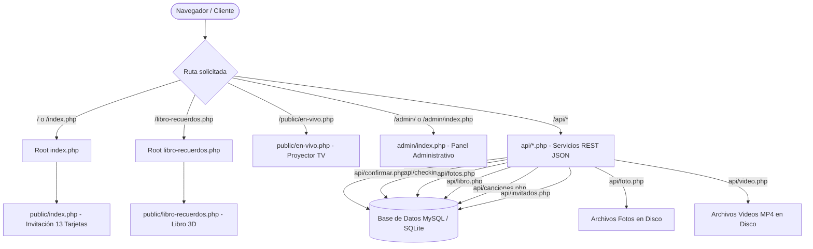

# AUDITORÍA TÉCNICA Y FUNCIONAL — PROYECTO INVITACIONANGIE
## DOCUMENTO 02: ARQUITECTURA TÉCNICA

---

### 1. STACK TECNOLÓGICO Y DEPENDENCIAS

El proyecto está construido sin dependencias de frameworks backend (como Laravel o Symfony) ni frameworks frontend (como React o Vue). Se basa en una arquitectura PHP pura (Vanilla PHP) orientada a la web tradicional con llamadas asíncronas vía Fetch API.

| Capa | Tecnología / Herramienta | Versión / Especificación | Rol en el Proyecto |
| :--- | :--- | :--- | :--- |
| **Backend Engine** | PHP | 8.0 - 8.2 (Compatible con 8.x) | Lógica de servidor, procesamiento de peticiones API, conexión PDO y renderizado de plantillas |
| **Web Server** | Apache HTTP Server | 2.4.x (vía Docker `php:8.2-apache`) | Servidor HTTP, manejo de rewrite rules, encabezados de autorización y compresión |
| **BBDD Primaria** | MySQL / MariaDB | MySQL 5.7+ / MariaDB 10.2+ | Persistencia relacional, motor InnoDB, charset `utf8mb4_unicode_ci` |
| **BBDD Fallback** | SQLite | SQLite 3 | Base de datos embebida autónoma utilizada automáticamente ante ausencia de servidor MySQL |
| **Frontend Core** | HTML5 / CSS3 / ES6+ | Estándares W3C nativos | Estructura semántica, animaciones 3D, lógica de navegación y manipulación de DOM |
| **Audio Processing** | Web Audio API | Nativo en navegadores modernos | Generación por software de beeps, crujidos de pergamino y fanfarrias sin librerías pesadas |

#### Dependencias Externas (Cargadas mediante CDN):

1. **Google Fonts (Tipografías remotas):**
   - `Great Vibes` (Caligrafía para nombres y títulos principales)
   - `Playfair Display` (Serif de alta elegancia para subtítulos)
   - `Montserrat` (Sans-serif legible para cuerpo de texto y botones)
   - `Cinzel Decorative` (Serif romana clásica para detalles en el libro y en vivo)
   - `Caveat` (Cursive estilo manuscrito para notas del libro de recuerdos)
2. **FontAwesome (Iconografía):**
   - `cdnjs.cloudflare.com/ajax/libs/font-awesome/6.5.1/css/all.min.css` (y 6.4.0 en en-vivo). Provee iconos de coronas, música, libros, regalos, tickets, cámaras, etc.
3. **QRCode.js:**
   - `cdnjs.cloudflare.com/ajax/libs/qrcodejs/1.0.0/qrcode.min.js`. Genera el código QR del Pase VIP en el navegador en un elemento `<canvas>` o ``.
4. **Html2Canvas:**
   - `cdnjs.cloudflare.com/ajax/libs/html2canvas/1.4.1/html2canvas.min.js`. Permite exportar visualmente el ticket VIP completo a un archivo de imagen descargable en formato PNG.
5. **Canvas-Confetti:**
   - `cdn.jsdelivr.net/npm/canvas-confetti@1.9.3/dist/confetti.browser.min.js`. Efectos visuales de explosión de confeti y estrellas al responder la trivia o confirmar asistencia.
6. **Html5-QRCode:**
   - `unpkg.com/html5-qrcode@2.3.8/html5-qrcode.min.js`. Librería de escaneo de códigos QR mediante la cámara web/móvil para la recepción del evento en `admin/index.php`.

---

### 2. CONFIGURACIÓN DEL SERVIDOR Y DESPLIEGUE (DOCKER & APACHE)

El repositorio incluye soporte nativo para despliegues contenerizados en plataformas modernas como Easypanel, Coolify, Portainer o servidores VPS con Docker.

#### Análisis del `Dockerfile`:
```dockerfile
FROM php:8.2-apache

# Instalación de extensiones SQLite y MySQL PDO
RUN apt-get update && apt-get install -y --no-install-recommends \
    libsqlite3-dev \
    && docker-php-ext-install pdo pdo_mysql pdo_sqlite \
    && apt-get clean \
    && rm -rf /var/lib/apt/lists/*

# Habilitación de módulos de Apache
RUN a2enmod rewrite headers

# Activación de AllowOverride para soporte de .htaccess
RUN sed -ri -e 's!AllowOverride None!AllowOverride All!g' /etc/apache2/apache2.conf

# Copia de archivos al DocumentRoot
COPY . /var/www/html/

# Permisos para persistencia de la base de datos SQLite y uploads
RUN mkdir -p /var/www/html/database && chown -R www-data:www-data /var/www/html && chmod -R 775 /var/www/html/database

EXPOSE 80
CMD ["apache2-foreground"]
```

#### Análisis del archivo `.htaccess` (En la raíz):
1. **Protección de Archivos Sensibles:**
   - Regla `<FilesMatch "^\.env|\.sql$|\.git"> Require all denied </FilesMatch>`. Bloquea peticiones directas desde el navegador a archivos `.env`, `.sql` o directorios `.git`.
2. **Desactivación de Listado de Directorios:**
   - `Options -Indexes`. Evita que usuarios curiosos listen el contenido de carpetas sin archivo índice.
3. **Pase de Autorización HTTP:**
   - `RewriteRule .* - [E=HTTP_AUTHORIZATION:%{HTTP:Authorization}]`. Garantiza que las cabeceras `Authorization` lleguen a PHP en entornos FastCGI / Apache.
4. **Mapeo Transparente de Recursos Estáticos:**
   - Si se solicita un archivo estático (ej. `/musica.mp3` o `/angie-portada.jpg`) y no existe en la raíz pero sí en `/public/`, Apache reescribe internamente la ruta hacia `public/$1`.

---

### 3. VARIABLES DE ENTORNO Y CONFIGURACIÓN

El proyecto carga variables de entorno mediante un parser propio en PHP (`config/database.php`), que lee el archivo `.env` línea por línea si existe en la raíz, evitando requerir librerías externas como `vlucas/phpdotenv`.

#### Variables Soportadas (según `.env.example` y `config/database.php`):

| Variable | Descripción | Valor por Defecto |
| :--- | :--- | :--- |
| `DB_HOST` / `DATABASE_HOST` / `MYSQL_HOST` | Host del servidor MySQL | `localhost` (o `127.0.0.1`) |
| `DB_PORT` / `DATABASE_PORT` / `MYSQL_PORT` | Puerto del servicio MySQL | `3306` |
| `DB_NAME` / `DATABASE_NAME` / `MYSQL_DATABASE` | Nombre de la base de datos | `invitacion_xv` |
| `DB_USER` / `DATABASE_USER` / `MYSQL_USER` | Usuario de base de datos | `root` |
| `DB_PASS` / `DB_PASSWORD` / `DATABASE_PASSWORD` | Contraseña de base de datos | *Vacío por defecto* |
| `ADMIN_USER` | Usuario para el panel administrativo | `admin` |
| `ADMIN_PASS` | Contraseña para el panel administrativo | `angie2026` |
| `MAX_ACOMPANANTES` | Límite máximo de acompañantes por invitado | `5` |

> [!IMPORTANT]
> **Compatibilidad Multientorno Detectada:** El código de `config/database.php` busca nombres de host comunes en Docker (`mysql`, `mariadb`, `database`, `db`, `127.0.0.1`) si la variable de host no está definida, facilitando la conexión en redes de contenedores sin configuración manual.

---

### 4. ESTRUCTURA DE ARCHIVOS Y DIRECTORIOS

A continuación se detalla la estructura física del repositorio y la función de cada elemento:

```text
InvitacionAngie/
│
├── .env.example                     # Plantilla de variables de entorno para desarrollo y producción
├── .gitignore                       # Ignora .env, bases de datos sqlite locales y carpetas temporales
├── .htaccess                        # Configuración de seguridad y reescritura de Apache
├── Dockerfile                       # Definición de contenedor Docker basado en php:8.2-apache
├── README.md                        # Documentación técnica básica original
│
├── index.php                        # Punto de entrada raíz: delega a public/index.php mediante require_once
├── libro-recuerdos.php              # Punto de entrada raíz alternativo: delega a public/libro-recuerdos.php
├── musica.mp3 / musica.m4a          # Archivos de audio de fondo (Valiente - Con toda libertad)
├── angie-portada.jpg                # Foto vertical de Angie para la portada de la invitación
├── angie-xv.jpg                     # Foto vertical de Angie para la tarjeta de despedida
├── favicon.ico / png / svg          # Favicons con el icono de la corona real esmeralda y dorada
│
├── admin/                           # PANEL DE ADMINISTRACIÓN
│   └── index.php                    # Monolito del panel admin (2,126 líneas): login, tabla, QR scanner, rifa, CSV, ZIP
│
├── api/                             # CAPA DE SERVICIOS REST JSON
│   ├── canciones.php                # GET (listar) / POST (sugerir canciones para la fiesta)
│   ├── checkin.php                  # POST/GET (procesar lectura de QR y registrar asistencia en puerta)
│   ├── confirmar.php                # POST (procesar RSVP, acompañantes, asignar pases y rifa)
│   ├── foto.php                     # GET (servidor seguro de imágenes con soporte de caché)
│   ├── fotos.php                    # GET (listar fotos fiesta) / POST (subida multipart/base64) / POST like
│   ├── invitados.php                # GET (listar todos los confirmados y acompañantes)
│   ├── libro.php                    # GET (listar dedicatorias y videos) / POST (nueva dedicatoria) / POST like
│   └── video.php                    # GET (servidor streaming de video con HTTP Range 206)
│
├── config/                          # CONFIGURACIÓN DEL SISTEMA
│   └── database.php                 # Motor de conexión PDO inteligente (MySQL con fallback a SQLite)
│
├── database/                        # ESQUEMAS, SCRIPTS Y ALMACENAMIENTO DE BBDD
│   ├── schema.sql                   # Esquema DDL inicial para MySQL (desactualizado)
│   ├── seed_fotos.sql               # Script SQL de siembra para fotos de la fiesta
│   ├── invitacion_xv.sqlite         # Archivo físico de la base de datos SQLite activa
│   ├── importar_fotos.php           # Script CLI para procesar e importar fotos desde carpeta local
│   ├── importar_videos.php          # Script CLI para procesar e importar videos MP4
│   └── uploads/                     # Directorio de almacenamiento de archivos multimedia
│       ├── fotos/                   # 160 fotos JPG de recuerdos de fiesta
│       └── videos/                  # 19 videos MP4 de momentos de fiesta
│
└── public/                          # FRONTEND PÚBLICO
    ├── index.php                    # Invitación interactiva principal (5,161 líneas: 13 tarjetas, audio, RSVP)
    ├── libro-recuerdos.php          # Libro Mágico 3D de Recuerdos (2,828 líneas: flipbook, fotos, videos)
    ├── en-vivo.php                  # Pantalla de proyección en vivo para TV / Video Beam (558 líneas)
    ├── favicon.*                    # Copias de favicons para acceso directo
    ├── musica.* / angie-*.jpg       # Copias de recursos multimedia de portada y música
    └── assets/                      # Recursos multimedia públicos servidos directamente
        ├── fotos/                   # Réplica de las 160 fotos JPG
        └── videos/                  # Réplica de los 19 videos MP4
```

---

### 5. SISTEMA DE RUTAS Y PUNTOS DE ENTRADA

El sistema carece de un *Front Controller* o router centralizado. Las rutas corresponden a accesos directos por sistema de archivos (*File-based routing*):



#### Dualidad de Puntos de Entrada:
Existen dos formas en que el proyecto puede ser servido:
1. **DocumentRoot apuntando a la raíz del repositorio (`/`):** El usuario ingresa a `http://dominio/` y `index.php` ejecuta `require_once 'public/index.php'`. En este caso, el enlace del panel admin `/admin/` funciona correctamente.
2. **DocumentRoot apuntando a `/public` (Estándar de seguridad web):** Si el servidor se configura con DocumentRoot en `public/`, la invitación abre directamente, pero la ruta `/admin/` **deja de estar accesible**, a menos que se configure un alias en Apache.

---

### 6. ORGANIZACIÓN DEL FRONTEND Y BACKEND

#### Frontend:
- **Estructura Monolítica Embebida:** No existen carpetas separadas `/css` o `/js`. Las más de 2,000 líneas de CSS y las cientos de líneas de JS se encuentran incrustadas dentro de los mismos archivos `.php` dentro de etiquetas `<style>` y `<script>`.
- **Renderizado del Lado del Cliente (CSR) + SSR Básico:** Las vistas HTML iniciales se sirven como plantillas PHP. Las interacciones posteriores (cambio de tarjetas, carga de fotos, envío de dedicatorias, sugerencia de canciones, filtrado de tablas y sorteo de ruleta) son procesadas en el navegador mediante JavaScript asíncrono con `fetch()`.

#### Backend:
- **Scripts de Procedimiento Directo:** Cada endpoint en `/api/` es un script independiente que:
  1. Configura encabezados CORS y JSON.
  2. Incluye `config/database.php`.
  3. Llama a `getDBConnection()`.
  4. Valida parámetros de `php://input` o `$_POST`/`$_GET`.
  5. Ejecuta sentencias SQL mediante sentencias preparadas PDO.
  6. Emite un `json_encode()` con el resultado.

---

### 7. MECANISMO DE CONEXIÓN A BASE DE DATOS (PDO DUAL ENGINE)

El archivo `config/database.php` contiene la lógica medular de persistencia del proyecto:

1. **Intento Primario con MySQL:**
   - Construye el DSN: `mysql:host=$dbHost;port=$dbPort;dbname=$dbName;charset=utf8mb4`.
   - Si la conexión falla con código de base de datos inexistente (código 1049), intenta conectarse al servidor sin nombre de base de datos y ejecuta un `CREATE DATABASE IF NOT EXISTS`.
2. **Fallback Automático a SQLite:**
   - Si la extensión `pdo_sqlite` está presente y MySQL no responde, abre el archivo `database/invitacion_xv.sqlite`.
   - Modifica dinámicamente la variable global `$currentDbEngine = 'sqlite'`.
3. **Autocreación de Tablas (`ensureTablesExist`):**
   - Ejecuta sentencias `CREATE TABLE IF NOT EXISTS` adaptadas para MySQL o SQLite.
   - Aplica migraciones automáticas al vuelo (ejemplo: si falta la columna `asistio_evento` o `checkin_at` en `invitados`, ejecuta un `ALTER TABLE`).
4. **Generador de Códigos de Rifa Únicos (`generarCodigoRifaUnico`):**
   - Genera cadenas aleatorias formato `RIFA-XXXX` (entre 1000 y 9999) y comprueba colisiones simultáneamente contra `invitados` y `acompanantes`.
5. **Poblador Retroactivo (`populateMissingRaffleCodes`):**
   - Si existen invitados o acompañantes sin código de rifa asignado, les asigna uno de forma retroactiva.

---

### 8. SERVICIOS EXTERNOS INTEGRADOS

| Servicio | Implementación | Propósito |
| :--- | :--- | :--- |
| **Google Calendar** | Enlace URL con formato `https://calendar.google.com/calendar/render?action=TEMPLATE...` | Permite al invitado agregar el evento del 3 de octubre de 2026 a su calendario de Google con un clic |
| **Google Maps** | Enlace URL directo: `https://maps.google.com/?q=Colegio+de+Medicos...` | Abre la ubicación geográfica del salón en Mérida en la app de mapas del teléfono |
| **QR Code Server API** | `https://api.qrserver.com/v1/create-qr-code/?size=180x180&data=...` | Usado como respaldo automático en caso de que la librería local `qrcode.min.js` falle al generar el pase |

---

### 9. SISTEMA DE ALMACENAMIENTO Y REDUNDANCIA DE ASSETS

Existe una duplicación física notable de recursos multimedia en el repositorio:

```text
Fotos de la fiesta:
├── database/uploads/fotos/   --> 160 archivos JPG (14.03 MB)
└── public/assets/fotos/      --> 160 archivos JPG (14.03 MB) [RÉPLICA EXACTA]

Videos de la fiesta:
├── database/uploads/videos/  --> 19 archivos MP4 (58.61 MB)
└── public/assets/videos/     --> 19 archivos MP4 (58.61 MB) [RÉPLICA EXACTA]
```

**Causa identificada:** Originalmente los archivos se almacenaron en `database/uploads/`. Debido a que muchas configuraciones de Apache impiden servir archivos fuera de `public/` o generan errores de rutas relativas, se duplicaron los archivos en `public/assets/`. Posteriormente se implementaron fallbacks en `api/foto.php` y `api/video.php` que buscan primero en `public/assets/` y luego en `database/uploads/`.
