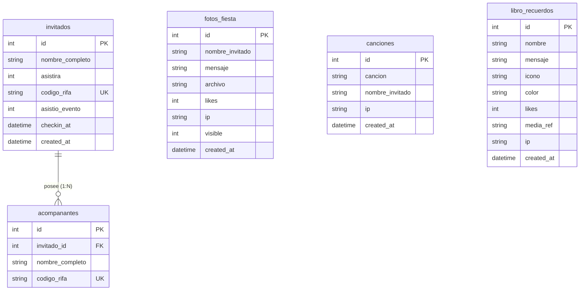

# AUDITORÍA TÉCNICA Y FUNCIONAL — PROYECTO INVITACIONANGIE
## DOCUMENTO 04: AUDITORÍA DE BASE DE DATOS

---

### 1. MOTORES DE BASE DE DATOS SOPORTADOS

El sistema está diseñado para operar bajo dos motores relacionales diferenciados mediante una capa de abstracción PDO híbrida en `config/database.php`:

1. **MySQL 5.7+ / MariaDB 10.2+ (Motor de Producción Principal):**
   - Motor de almacenamiento: `InnoDB`.
   - Conjunto de caracteres (*Charset*): `utf8mb4`.
   - Collation: `utf8mb4_unicode_ci` (Soporte completo de tildes, caracteres latinos y emojis).
   - Modo de conexión: TCP Forzado (`127.0.0.1`) para evitar errores de sockets Unix en contenedores Linux.
2. **SQLite 3 (Motor Embebido / Fallback de Alta Resiliencia):**
   - Archivo de base de datos: `database/invitacion_xv.sqlite` (65,536 bytes en el repositorio).
   - Permite que la aplicación funcione en desarrollo local o contenedores sin necesidad de un servidor MySQL levantado.

---

### 2. ESTRUCTURA DETALLADA DE LAS TABLAS

A partir de la inspección directa del archivo activo `database/invitacion_xv.sqlite` y la lógica de creación en `config/database.php`, se identifican **5 tablas operativas**:

---

#### 2.1. Tabla: `invitados` (Titulares de la Confirmación)
Registra a la persona principal que confirma asistencia mediante el formulario RSVP.

| Campo | Tipo MySQL | Tipo SQLite | Nulo | Por Defecto | Restricciones / Claves | Propósito |
| :--- | :--- | :--- | :---: | :---: | :--- | :--- |
| `id` | `INT` | `INTEGER` | NO | *Auto* | **PRIMARY KEY** (Auto Increment) | Identificador numérico del invitado titular |
| `nombre_completo` | `VARCHAR(150)` | `TEXT` | NO | - | Validación regex de letras | Nombre y apellido del titular |
| `asistira` | `TINYINT(1)` | `INTEGER` | NO | `1` | Índice `idx_asistira` | `1` = Sí asistirá, `0` = Declina invitación |
| `codigo_rifa` | `VARCHAR(20)` | `TEXT` | SÍ | `NULL` | **UNIQUE**, Índice `idx_codigo_rifa` | Código único para la rifa (ej. `RIFA-4821`) |
| `asistio_evento` | `TINYINT(1)` | `INTEGER` | NO | `0` | Índice `idx_asistio_evento` | Estado del check-in (`1` = presente en salón) |
| `checkin_at` | `DATETIME` | `DATETIME` | SÍ | `NULL` | - | Marca de tiempo exacta del ingreso al salón |
| `created_at` | `DATETIME` | `DATETIME` | NO | `CURRENT_TIMESTAMP` | Índice `idx_created_at` | Fecha y hora en que completó el RSVP |

---

#### 2.2. Tabla: `acompanantes` (Familiares o Amigos del Titular)
Registra a las personas adicionales que asisten bajo el pase del titular.

| Campo | Tipo MySQL | Tipo SQLite | Nulo | Por Defecto | Restricciones / Claves | Propósito |
| :--- | :--- | :--- | :---: | :---: | :--- | :--- |
| `id` | `INT` | `INTEGER` | NO | *Auto* | **PRIMARY KEY** (Auto Increment) | Identificador único del acompañante |
| `invitado_id` | `INT` | `INTEGER` | NO | - | **FOREIGN KEY** -> `invitados(id)` | Vínculo relacional con el titular (`ON DELETE CASCADE`) |
| `nombre_completo` | `VARCHAR(150)` | `TEXT` | NO | - | Validación regex | Nombre del acompañante |
| `codigo_rifa` | `VARCHAR(20)` | `TEXT` | SÍ | `NULL` | **UNIQUE**, Índice `idx_acomp_codigo_rifa` | Código individual e independiente de rifa |

---

#### 2.3. Tabla: `fotos_fiesta` (Álbum de Recuerdos en Vivo)
Almacena las fotografías compartidas por los invitados durante la noche y las fotos oficiales precargadas.

| Campo | Tipo MySQL | Tipo SQLite | Nulo | Por Defecto | Restricciones / Claves | Propósito |
| :--- | :--- | :--- | :---: | :---: | :--- | :--- |
| `id` | `INT` | `INTEGER` | NO | *Auto* | **PRIMARY KEY** (Auto Increment) | Identificador secuencial de la fotografía |
| `nombre_invitado` | `VARCHAR(150)` | `TEXT` | NO | - | - | Nombre de quien tomó la fotografía o pie oficial |
| `mensaje` | `TEXT` | `TEXT` | SÍ | `NULL` | - | Mensaje emotivo adjunto a la fotografía |
| `archivo` | `VARCHAR(255)` | `TEXT` | NO | - | - | Nombre físico del archivo (`angie_xv_recuerdo_001.jpg`) |
| `likes` | `INT` | `INTEGER` | NO | `0` | - | Conteo acumulado de "me gusta" de invitados |
| `ip` | `VARCHAR(45)` | `TEXT` | SÍ | `NULL` | - | Dirección IP del cliente remitente (IPv4 / IPv6) |
| `visible` | `TINYINT(1)` | `INTEGER` | NO | `1` | Índice `idx_visible` | Moderación: `1` = visible, `0` = oculta por admin |
| `created_at` | `DATETIME` | `DATETIME` | NO | `CURRENT_TIMESTAMP` | Índice `idx_created_at` | Fecha de captura o registro |

---

#### 2.4. Tabla: `canciones` (Sugerencias de la Playlist)
Lista de canciones solicitadas por los invitados para ambientar la fiesta.

| Campo | Tipo MySQL | Tipo SQLite | Nulo | Por Defecto | Restricciones / Claves | Propósito |
| :--- | :--- | :--- | :---: | :---: | :--- | :--- |
| `id` | `INT` | `INTEGER` | NO | *Auto* | **PRIMARY KEY** (Auto Increment) | Identificador numérico de la canción |
| `cancion` | `VARCHAR(255)` | `TEXT` | NO | - | - | Título de la pista y nombre del artista |
| `nombre_invitado` | `VARCHAR(150)` | `TEXT` | SÍ | `NULL` | - | Nombre del invitado que sugirió la canción |
| `ip` | `VARCHAR(45)` | `TEXT` | SÍ | `NULL` | - | Dirección IP para trazabilidad |
| `created_at` | `DATETIME` | `DATETIME` | NO | `CURRENT_TIMESTAMP` | Índice `idx_created_at` | Fecha y hora de la propuesta |

---

#### 2.5. Tabla: `libro_recuerdos` (Dedicatorias y Muro de Deseos)
Contiene las dedicatorias, bendiciones y firmas virtuales plasmadas en el Libro Mágico 3D.

| Campo | Tipo MySQL | Tipo SQLite | Nulo | Por Defecto | Restricciones / Claves | Propósito |
| :--- | :--- | :--- | :---: | :---: | :--- | :--- |
| `id` | `INT` | `INTEGER` | NO | *Auto* | **PRIMARY KEY** (Auto Increment) | Identificador de la dedicatoria |
| `nombre` | `VARCHAR(150)` | `TEXT` | NO | - | - | Nombre del firmante o grupo familiar |
| `mensaje` | `TEXT` | `TEXT` | NO | - | - | Contenido del mensaje de felicitaciones |
| `icono` | `VARCHAR(50)` | `TEXT` | SÍ | `'✨'` | - | Emoji o sticker asociado (`👑`, `✨`, `💖`, `🥂`, `🌟`) |
| `color` | `VARCHAR(30)` | `TEXT` | SÍ | `'gold'` | - | Tema visual (`gold`, `emerald`, `rose`, `cream`, etc.) |
| `likes` | `INT` | `INTEGER` | NO | `0` | - | Conteo de corazones / likes en la tarjeta |
| `media_ref` | `VARCHAR(255)` | `TEXT` | SÍ | `NULL` | - | Referencia opcional a un archivo de foto adjunta |
| `ip` | `VARCHAR(45)` | `TEXT` | SÍ | `NULL` | - | IP de auditoría |
| `created_at` | `DATETIME` | `DATETIME` | NO | `CURRENT_TIMESTAMP` | Índice `idx_created_at` | Fecha y hora de publicación |

---

### 3. HALLAZGO CRÍTICO: DISCREPANCIA ENTRE `schema.sql` Y EL CÓDIGO REAL

Se detectó una discrepancia severa de sincronización entre el script SQL oficial del repositorio y la lógica real del sistema:

1. **El archivo `database/schema.sql` está OBSOLETO:**
   - Solo contiene la definición de `invitados` y `acompanantes`.
   - **NO** contiene la creación de `fotos_fiesta`.
   - **NO** contiene la creación de `canciones`.
   - **NO** contiene la creación de `libro_recuerdos`.
   - En la tabla `invitados`, **NO** incluye las columnas `asistio_evento` ni `checkin_at`.
2. **Consecuencia técnica:**
   - Si un desarrollador o administrador de sistemas despliega el proyecto en un servidor nuevo siguiendo las instrucciones del `README.md` (`mysql -u root -p < database/schema.sql`), el sistema fallará a menos que la función `ensureTablesExist()` de `config/database.php` intercepte la ejecución y complete las tablas faltantes por código.

---

### 4. RECUENTO Y ESTADO DE LOS DATOS REALES EN EL REPOSITORIO

Al auditar la base de datos local `database/invitacion_xv.sqlite`, se constata el siguiente inventario de registros reales:

| Tabla | Registros Existentes | Observaciones |
| :--- | :---: | :--- |
| `invitados` | **0** | La tabla se encuentra limpia (sin datos de prueba de invitados). |
| `acompanantes` | **0** | Limpia. |
| `canciones` | **0** | Limpia. |
| `fotos_fiesta` | **160** | Contiene los 160 registros oficiales de fotografías precargadas para el álbum de Angie (nombres de archivo: `angie_xv_recuerdo_001.jpg` a `160.jpg`), con fechas simuladas correspondientes a la noche de la fiesta y likes asignados. |
| `libro_recuerdos` | **5** | Contiene 5 mensajes reales: 4 mensajes predefinidos de familiares y padrinos, más 1 mensaje adicional ("Tia Elena: Felicidades Angie hermosa!"). |

---

### 5. RELACIONES Y FLUJO DE DATOS ENTRE MÓDULOS

1. **Módulo RSVP -> Base de Datos:**
   - `api/confirmar.php` inicia una transacción PDO. Inserta 1 registro en `invitados` y genera un número `RIFA-XXXX`. Si se agregaron $N$ acompañantes, genera $N$ registros en `acompanantes`, cada uno con su propio código de rifa único.
   - En caso de reenvío por parte del mismo invitado, el sistema detecta el nombre existente y devuelve el pase previo sin duplicar filas.
2. **Módulo Check-in / Recepción -> Base de Datos:**
   - Al escanear el QR en la puerta del salón, `api/checkin.php` localiza al titular por ID o por código de rifa. Actualiza `asistio_evento = 1` y sella `checkin_at = CURRENT_TIMESTAMP`.
3. **Módulo Rifa -> Base de Datos:**
   - `admin/index.php` extrae en memoria todos los códigos de rifa válidos de `invitados` y de `acompanantes` para alimentar la ruleta aleatoria en vivo.
4. **Módulo Fotos y Proyector -> Base de Datos:**
   - `public/index.php` envía la imagen a `api/fotos.php`, que la almacena en disco y registra una fila en `fotos_fiesta`. `public/en-vivo.php` consulta periódicamente las filas visibles para proyectarlas en la pantalla gigante.
