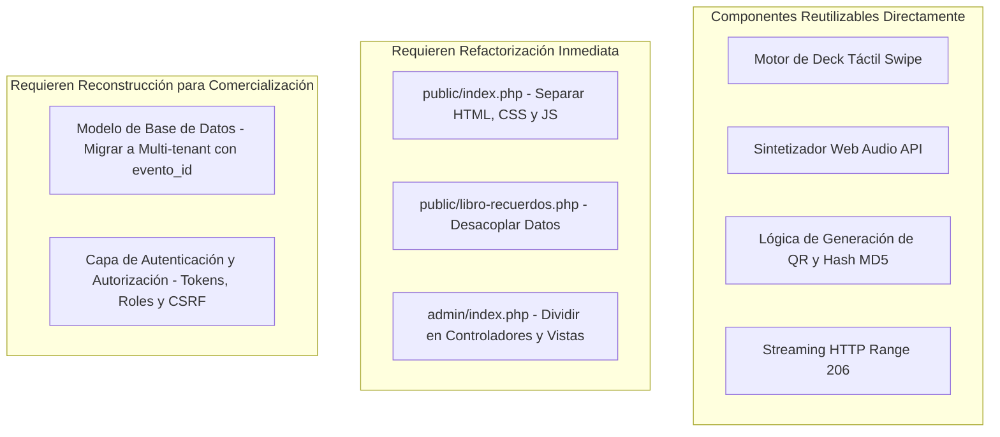

# AUDITORÍA TÉCNICA Y FUNCIONAL — PROYECTO INVITACIONANGIE
## DOCUMENTO 08: INFORME DE FUNCIONALIDADES PENDIENTES, ERRORES Y MEJORAS

---

### 1. BALANCE DEL ESTADO DEL PROYECTO

| Categoría | Total Identificado | Estado de Situación |
| :--- | :---: | :--- |
| **Funcionalidades Terminadas y Operativas** | **18** | Listas y funcionando en el contexto del evento de Angie |
| **Funcionalidades Incompletas o Pendientes** | **4** | Presentes en código pero sin flujo cerrado |
| **Errores / Bugs Lógicos Identificados** | **5** | Comportamientos anómalos o desincronizaciones |
| **Mejoras Técnicas Necesarias** | **8** | Optimización de rendimiento, seguridad y experiencia |
| **Componentes para Refactorización Inmediata** | **3** | Monolitos de código (`public/index.php`, `admin/index.php`, `libro`) |
| **Componentes que Requieren Reconstrucción** | **2** | Esquema SQL estático y capa de persistencia mono-evento |

---

### 2. DETALLE DE FUNCIONALIDADES TERMINADAS Y OPERATIVAS

1. **Deck vertical de 13 tarjetas táctiles con animaciones CSS** (`public/index.php`).
2. **Cuenta regresiva dinámica con enlace interactivo a Google Calendar** (`public/index.php`).
3. **Trivia interactiva de 5 preguntas con puntuación y confeti** (`public/index.php`).
4. **Formulario de sugerencia de canciones con inserción AJAX** (`public/index.php`, `api/canciones.php`).
5. **Módulo RSVP con acompañantes dinámicos (hasta 5) y validación anti-duplicados** (`public/index.php`, `api/confirmar.php`).
6. **Generador dinámico de Pase VIP con QR, hash de seguridad y boletos de rifa** (`public/index.php`, `api/confirmar.php`).
7. **Descargador de Pase VIP en imagen PNG mediante Html2Canvas** (`public/index.php`).
8. **Reproductor de audio de fondo con control flotante y audio nativo HTML5** (`public/index.php`, `musica.mp3`, `musica.m4a`).
9. **Libro Mágico 3D con animación de paso de páginas y textura de pergamino** (`public/libro-recuerdos.php`).
10. **Efecto de sonido de crujido de pergamino en tiempo real vía Web Audio API** (`public/libro-recuerdos.php`).
11. **Galería polaroid interactiva con 160 fotografías precargadas** (`public/libro-recuerdos.php`, `api/fotos.php`).
12. **Galería de 19 videos con streaming eficiente HTTP Range 206** (`public/libro-recuerdos.php`, `api/video.php`).
13. **Muro interactivo de dedicatorias con stickers, paletas de color y likes** (`public/libro-recuerdos.php`, `api/libro.php`).
14. **Pantalla en vivo para TV / Videobeam con carrusel a pantalla completa y sondeo automático** (`public/en-vivo.php`).
15. **Panel administrativo protegido por login y sesión** (`admin/index.php`).
16. **Escáner de pases QR con cámara WebRTC y registro de asistencia en puerta** (`admin/index.php`, `api/checkin.php`).
17. **Ruleta animada de sorteo de rifas con sintetizador sonoro y control de ganadores** (`admin/index.php`).
18. **Exportación de invitados a CSV con codificación UTF-8 BOM y exportación de fotos a ZIP** (`admin/index.php`).

---

### 3. FUNCIONALIDADES INCOMPLETAS O PENDIENTES

1. **Adjuntar fotos en las dedicatorias del Libro de Recuerdos:**
   - *Archivos involucrados:* `public/libro-recuerdos.php`, `api/libro.php`.
   - *Diagnóstico:* La base de datos incluye el campo `media_ref` en `libro_recuerdos`, pero el modal del frontend no tiene selector de archivo para adjuntar una foto junto al mensaje.
2. **Edición o rectificación de RSVP por parte del invitado:**
   - *Archivos involucrados:* `public/index.php`, `api/confirmar.php`.
   - *Diagnóstico:* Si un invitado ya confirmó pero necesita cambiar el nombre de un acompañante o cancelar su asistencia, el sistema bloquea el reenvío diciendo que "ya está registrado" y muestra su pase previo sin permitir modificar los datos.
3. **Gestión de múltiples eventos / celebraciones:**
   - *Archivos involucrados:* `admin/index.php`, `config/database.php`.
   - *Diagnóstico:* No existe interfaz para dar de alta otros eventos ni selector de eventos activos.
4. **Moderación de canciones sugeridas en tiempo real:**
   - *Archivos involucrados:* `admin/index.php`, `api/canciones.php`.
   - *Diagnóstico:* Las canciones sugeridas se muestran en la invitación sin aprobación previa; el admin solo puede borrarlas a posteriori.

---

### 4. ERRORES Y BUGS IDENTIFICADOS

1. **Desincronización en la eliminación de fotos:**
   - *Archivos involucrados:* `admin/index.php` (Líneas 414-451).
   - *Error:* Al borrar una foto desde el admin, el código busca y elimina el archivo físico en `database/uploads/fotos/`. Sin embargo, las 160 fotos iniciales también existen en `public/assets/fotos/`. Como `api/foto.php` busca primero en `public/assets/fotos/`, la foto sigue mostrándose aunque el admin crea haberla eliminado.
2. **Desactualización crítica del esquema SQL:**
   - *Archivos involucrados:* `database/schema.sql`.
   - *Error:* El script no contiene las tablas `fotos_fiesta`, `canciones`, `libro_recuerdos`, ni las columnas `asistio_evento` y `checkin_at`. Si se importa en una base de datos nueva, la aplicación depende de que PHP ejecute las sentencias DDL al vuelo.
3. **Ruta absoluta en enlace del panel administrativo:**
   - *Archivos involucrados:* `public/index.php` (Línea 3444).
   - *Error:* El botón flotante de acceso al panel tiene `href="/admin/"`. Si el proyecto se ejecuta en un subdirectorio (ej. `localhost/InvitacionAngie/`), el enlace rompe y dirige a `localhost/admin/` (Error 404). Debe ser relativo (`../admin/` o dinámico).
4. **Duplicación redundante de 145 MB en disco:**
   - *Archivos involucrados:* `public/assets/` y `database/uploads/`.
   - *Error:* Dos copias exactas de todas las fotos y videos ocupan almacenamiento innecesario y generan confusión sobre cuál es la fuente de verdad.
5. **Fuga de excepciones PDO al cliente:**
   - *Archivos involucrados:* `api/confirmar.php`, `api/invitados.php`.
   - *Error:* En caso de fallo de conexión o consulta, se envía `$e->getMessage()` directamente en el JSON de respuesta.

---

### 5. CLASIFICACIÓN DE COMPONENTES SEGÚN ACCIÓN REQUERIDA

