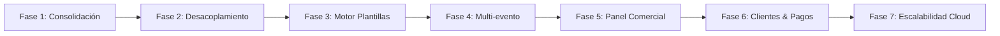

# AUDITORÍA TÉCNICA Y FUNCIONAL — PROYECTO INVITACIONANGIE
## DOCUMENTO 09: PROPUESTA ESTRATÉGICA DE EVOLUCIÓN EN FASES

---

### 1. HOJA DE RUTA GENERAL (ROADMAP)

Para transformar exitosamente `InvitacionAngie` en una plataforma comercial SaaS de invitaciones interactivas de alta gama, se propone una estrategia de evolución dividida en **7 fases progresivas y no destructivas**:

---

### 2. DETALLE DE CADA FASE DE EVOLUCIÓN

#### FASE 1: Consolidación y Estabilización del Proyecto Actual
- **Objetivo:** Subsanar los bugs identificados en la auditoría, corregir la desincronización de archivos y actualizar el esquema SQL sin alterar la interfaz de usuario ni la experiencia de Angie.
- **Componentes involucrados:** Servidor de fotos (`api/foto.php`), panel de administración (`admin/index.php`), script DDL (`database/schema.sql`) y enlaces relativos.
- **Archivos que requerirían cambios:**
  - `admin/index.php`: Eliminar contraseñas fijas de fallback y corregir el borrado físico de fotos para que afecte tanto a `database/uploads/fotos/` como a `public/assets/fotos/`.
  - `database/schema.sql`: Actualizar con las 5 tablas completas, tipos e índices.
  - `public/index.php`: Ajustar el enlace `/admin/` a una ruta relativa (`../admin/` o detectada dinámicamente).
- **Dependencias:** Ninguna (PHP y SQL nativos).
- **Riesgos:** Muy bajo. No altera la base de datos en producción.
- **Prioridad:** **MÁXIMA (Inmediata)**.

---

#### FASE 2: Separación de Información y Diseño (Desacoplamiento de Datos)
- **Objetivo:** Extraer todos los textos, fechas, nombres, paletas de colores y preguntas de trivia de los archivos HTML/PHP hacia una estructura de datos centralizada (archivo JSON o tabla de configuración en BBDD).
- **Componentes involucrados:** Invitación principal, Libro 3D, Trivia, Itinerario y Pantalla en Vivo.
- **Archivos que requerirían cambios:**
  - `config/evento_config.json` (o tabla `evento_config`): Creación del esquema con los campos: `nombre_quinceanera`, `fecha_evento`, `fecha_cumpleanos`, `padres`, `itinerario`, `trivia`, `paleta_colores`, `musica_url`.
  - `public/index.php`: Reemplazar los textos fijos por variables inyectadas desde el archivo de configuración.
  - `public/libro-recuerdos.php`: Cargar títulos, videos y fotos desde la configuración.
- **Dependencias:** Parser JSON estándar de PHP.
- **Riesgos:** Bajo. Requiere pruebas de regresión visual para asegurar que ningún texto pierda formato tipográfico.
- **Prioridad:** **ALTA**.

---

#### FASE 3: Motor de Plantillas y Componentes Modulares
- **Objetivo:** Romper los archivos gigantescos (`public/index.php` de 5,161 líneas y `public/libro-recuerdos.php` de 2,828 líneas) en una arquitectura basada en componentes y hojas de estilo separadas.
- **Componentes involucrados:** Componentes individuales de tarjeta (Tarjeta Tiara, Tarjeta Cuenta Regresiva, Tarjeta Trivia, Tarjeta RSVP, etc.).
- **Archivos que requerirían cambios:**
  - Creación de carpetas `/src/Views/Components/` o `/templates/cards/`.
  - Extracción del CSS en archivos limpios: `styles-deck.css`, `styles-book.css`, `theme-emerald-gold.css`.
  - Posibilidad de adoptar un motor de plantillas ligero como **Plates PHP** o **Twig** para compilación limpia de HTML.
- **Dependencias:** Composer para gestión de paquetes si se opta por Twig.
- **Riesgos:** Medio. Requiere asegurar que las transiciones CSS y animaciones JS mantengan su sincronización exacta.
- **Prioridad:** **MEDIA**.

---

#### FASE 4: Arquitectura Multi-Celebración (Multi-Tenancy)
- **Objetivo:** Permitir que la plataforma gestione múltiples celebraciones en una sola instalación mediante identificación por *slug* en la URL (ej. `/invitacion/angie-xv`, `/invitacion/sofia-xv`).
- **Componentes involucrados:** Capa de rutas (*Router*), base de datos relacional y servicios API.
- **Archivos que requerirían cambios:**
  - `database/schema.sql`: Creación de la tabla `eventos` (`id`, `slug`, `tipo_evento`, `nombre_festejado`, `fecha`, `config_json`, `created_at`).
  - Agregar la columna `evento_id INT NOT NULL` en `invitados`, `acompanantes`, `fotos_fiesta`, `canciones` y `libro_recuerdos` con sus respectivas Foreign Keys e índices.
  - Creación de un router centralizado `public/index.php` que capture el slug y cargue el evento correspondiente.
  - Endpoints de `/api/*.php`: Exigir el parámetro `evento_id` o `slug` en todas las consultas.
- **Dependencias:** Módulo Apache `mod_rewrite` o router PHP (`Bramus Router` o similar).
- **Riesgos:** Alto. Requiere migración cuidadosa de datos para no desasociar los registros existentes de Angie.
- **Prioridad:** **ALTA (Crucial para comercialización)**.

---

#### FASE 5: Panel de Administración Comercial y Gestión de Anfitriones
- **Objetivo:** Dotar a la plataforma de un panel administrativo dual: un **SuperAdmin** para los creadores de la plataforma y un **Portal de Anfitrión** para que cada cliente (padres de la quinceañera o novios) gestione su evento.
- **Componentes involucrados:** Autenticación por roles, panel de control de invitados, estadísticas y personalización.
- **Archivos que requerirían cambios:**
  - `admin/`: Reestructuración completa.
  - Tabla `usuarios` (`id`, `email`, `password_hash`, `rol`: `superadmin` / `anfitrion`, `evento_id`).
  - Implementación de tokens JWT o sesiones seguras con protección CSRF en todos los formularios.
  - Interfaz de usuario para que el anfitrión edite sus fotos, revise el libro de recuerdos y descargue su CSV de invitados.
- **Dependencias:** Librería de hashing de contraseñas (`password_hash` nativo de PHP), librerías de componentes UI modernos.
- **Riesgos:** Medio. Requiere diseño estricto de control de acceso para evitar que un anfitrión acceda a los datos de otro evento.
- **Prioridad:** **MEDIA**.

---

#### FASE 6: Gestión de Clientes, Paquetes y Pedidos
- **Objetivo:** Automatizar la comercialización mediante la definición de planes y paquetes (Básico, Prémium, Diamante), cotizador interactivo y cobro en línea.
- **Componentes involucrados:** Módulo de facturación, pasarelas de pago y aprovisionamiento automático.
- **Archivos que requerirían cambios:**
  - Nuevas tablas: `planes` (`id`, `nombre`, `limite_invitados`, `incluye_libro_3d`, `incluye_proyector`, `precio`), `pedidos` y `pagos`.
  - Integración de pasarelas de pago (Stripe, PayPal, MercadoPago o métodos locales de transferencia).
  - Aprovisionamiento automático: Al confirmarse el pago, el sistema genera el evento y envía al cliente sus credenciales de acceso.
- **Dependencias:** SDKs oficiales de pasarelas de pago.
- **Riesgos:** Medio-Alto (Manejo de transacciones financieras y cumplimiento normativo).
- **Prioridad:** **MEDIA-BAJA (Depende de la estrategia de ventas)**.

---

#### FASE 7: Escalabilidad Cloud, CDN y Automatización
- **Objetivo:** Preparar la infraestructura para soportar cientos de eventos simultáneos con miles de invitados concurrentes subiendo fotos y reproduciendo videos sin degradación de velocidad.
- **Componentes involucrados:** Almacenamiento de objetos en la nube, optimización de medios y entrega de contenidos.
- **Archivos que requerirían cambios:**
  - `api/foto.php`, `api/video.php`, `api/fotos.php`: Reemplazar el almacenamiento en disco local por subidas directas firmadas (*presigned URLs*) a **Cloudflare R2** o **AWS S3**.
  - Pipeline de procesamiento de imágenes: Redimensionamiento automático y conversión a formato WebP/AVIF en el momento de la subida para ahorrar un 70% de ancho de banda.
  - Despliegue en arquitectura elástica (Docker en Kubernetes o Cloud Run) con base de datos administrada (Cloud SQL / Amazon RDS).
- **Dependencias:** AWS SDK for PHP o cliente S3 compatible, ImageMagick / GD.
- **Riesgos:** Bajo a nivel de código, dependiente de costos de infraestructura cloud.
- **Prioridad:** **BAJA (A ejecutar cuando el volumen de clientes supere la capacidad del VPS)**.

---

### 3. RESUMEN DE PRIORIZACIÓN Y CRONOGRAMA RECOMENDADO

| Fase | Denominación | Impacto Comercial | Esfuerzo Estimado | Dependencias Previas |
| :---: | :--- | :---: | :---: | :---: |
| **Fase 1** | Consolidación y corrección de bugs | Estabilidad actual | 1 - 2 días | Ninguna |
| **Fase 2** | Desacoplamiento de datos (Config JSON) | Agilidad operativa | 3 - 5 días | Fase 1 |
| **Fase 3** | Motor de plantillas modulares | Mantenibilidad | 1 semana | Fase 2 |
| **Fase 4** | Arquitectura Multi-evento (Multi-tenancy) | **Hito crítico comercial** | 1 - 2 semanas | Fase 2 y 3 |
| **Fase 5** | Panel comercial para anfitriones | Experiencia de cliente | 1 - 2 semanas | Fase 4 |
| **Fase 6** | Pagos y paquetes automatizados | Monetización | 2 semanas | Fase 5 |
| **Fase 7** | Escalabilidad Cloud (S3/R2/CDN) | Rendimiento masivo | 1 semana | Fase 4 |
