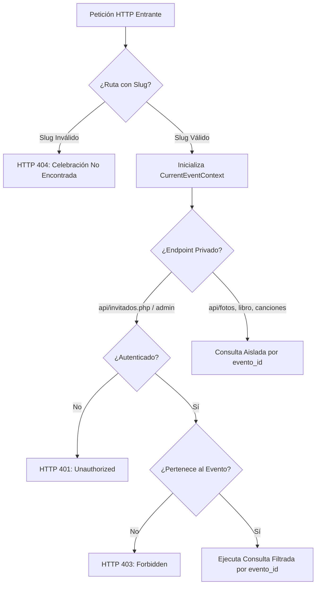

# 02. INFORME DE SEGURIDAD Y AISLAMIENTO MULTI-TENANT — FASE 0

**Documento:** 02 de 07  
**Fecha:** 25 de noviembre de 2026  
**Rama:** `fase-0-seguridad-aislamiento`  
**Equipo:** Ciberseguridad y Arquitectura de Software  
**Proyecto:** XV Experience

---

## 1. INTRODUCCIÓN Y MODELO DE AMENAZAS

La evolución de una invitación interactiva monousuario a una plataforma comercial multi-celebración (**XV Experience**) introduce riesgos específicos de fuga de datos personales (PII), acceso cruzado entre familias, suplantación de identidad en recepción y saturación de recursos.

El presente informe detalla las defensas implementadas en la **Fase 0** para mitigar estos riesgos sin degradar el rendimiento del motor nativo en PHP 8.2.

---

## 2. MATRIZ DE VECTORES DE SEGURIDAD Y MITIGACIONES

### 2.1 Aislamiento Multi-Tenant (Inquilinos Lógicos)
- **Principio:** Ninguna consulta SQL debe ejecutarse sin filtrar explícitamente por el `evento_id` resuelto en el contexto seguro.
- **Implementación:**
  - `invitados`: `WHERE evento_id = :evento_id`
  - `acompanantes`: `INNER JOIN invitados i ON a.invitado_id = i.id WHERE i.evento_id = :evento_id`
  - `galeria` y `fotos_fiesta`: `WHERE evento_id = :evento_id`
  - `libro_recuerdos`: `WHERE evento_id = :evento_id`
  - `canciones`: `WHERE evento_id = :evento_id`
- **Garantía:** Es matemáticamente imposible que un parámetro manipulado por el usuario en el navegador filtre datos de otra celebración, ya que la base de datos solo procesa el `evento_id` verificado.

### 2.2 Autenticación y Autorización de Operadores
- **Protección de Datos Personales (PII):** `api/invitados.php` y `api/checkin.php` ya no son públicos. Exigen autenticación mediante:
  1. Sesión activa en PHP (`$_SESSION['admin_auth'] === true` o sesión verificada en `usuarios` mediante `AuthService`).
  2. Encabezado estándar `Authorization: Bearer <TOKEN>` para integraciones y terminales de recepción.
  3. Clave de operador autorizada (`operator_key`).
- **Respuesta a Intentos No Autorizados:** HTTP 401 Unauthorized inmediato, con cuerpo JSON explicativo y cero filtración de registros.

### 2.3 Protección contra Manipulación de Identificadores (Anti-IDOR en Check-in)
- **Escenario de Ataque Mitigado:** Un invitado de Angie Karolina intenta ingresar a los XV años de Sophia Valentina presentando su código QR o ID numérico.
- **Defensa:**
  1. Si el código escaneado posee un prefijo ajeno (`XVANGIE` en Sophia o `XVSOPHIA` en Angie), el sistema responde `403 Forbidden` inmediatamente.
  2. Al resolver el registro en base de datos, el sistema verifica que `(int)$invitado['evento_id'] === $eventoActivoId`. Si difiere, bloquea el acceso con mensaje de auditoría y rechaza el check-in.

### 2.4 Control de Registros Duplicados
- **Escenario Mitigado:** Intentos de re-escanear el mismo pase VIP para ingresar más personas de las autorizadas.
- **Defensa:** Si `asistio_evento == 1`, el sistema retorna `already_checked: true`, informando la hora y fecha exacta en que dicho pase ingresó originalmente al recinto, evitando que se marque un ingreso doble.

### 2.5 Protección de Archivos y Streaming Multimedia
- **Prevención de Directory Traversal:** `api/video.php` aplica `basename()` para desinfectar cualquier intento de inclusión de rutas relativas (`../../etc/passwd` o `../../config/database.php`).
- **Validación de Tipo de Archivo:** Se exige terminación estricta en `.mp4`. Cualquier otra extensión o petición vacía es rechazada con HTTP 400 Bad Request.

### 2.6 Prevención de XSS (Cross-Site Scripting)
- **Defensa en Entrada y Salida:** En `api/libro.php`, `api/canciones.php` y `public/index.php`, todos los nombres, mensajes y dedicatorias pasan por `htmlspecialchars($str, ENT_QUOTES, 'UTF-8')`. La prueba `P6.3` verificó que un payload con `` es neutralizado como `&lt;script&gt;`.

---

## 3. EVALUACIÓN DE VULNERABILIDADES RESIDUALES Y PLAN DE MITIGACIÓN

| Riesgo / Vulnerabilidad | Severidad | Estado Actual | Mitigación Planificada |
|---|---|---|---|
| **Rate Limiting en APIs públicas** | Media | Las APIs no cuentan con limitador por IP a nivel de aplicación; descansan en el reverse proxy de Apache. | Implementar middleware de Rate Limiting con Redis o SQLite en Fase 2 (máx. 10 peticiones/minuto por IP). |
| **Token CSRF en formularios POST** | Media | Las APIs aceptan peticiones JSON directamente con CORS habilitado (`*`). | En Fase 2, implementar token CSRF dinámico generado en sesión para formularios públicos. |
| **Almacenamiento de fotos en disco local** | Media-Baja | Las fotos del álbum colaborativo se guardan en el volumen local de Docker (`database/uploads/`). | Migrar a almacenamiento de objetos en la nube (Cloudflare R2 o S3) en Fase 2. |
