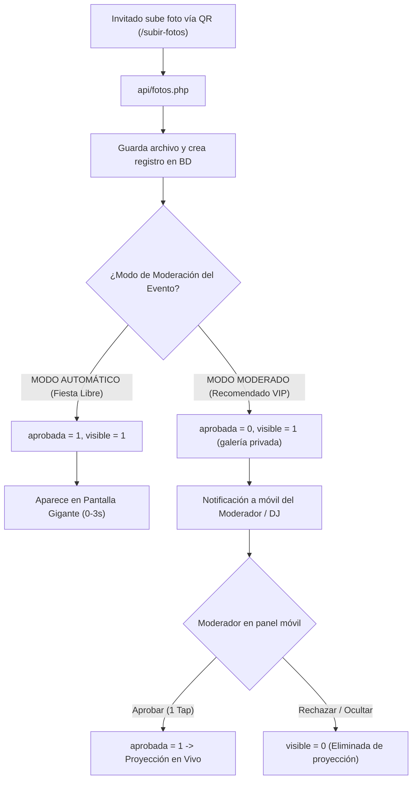

# 05. PROPUESTA TÉCNICA: MODERACIÓN PREVENTIVA DE FOTOGRAFÍAS EN VIVO

**Documento:** 05 de 07  
**Fecha:** 25 de noviembre de 2026  
**Área:** Arquitectura de Producto, UX y Seguridad  
**Proyecto:** XV Experience

---

## 1. CONTEXTO Y PROBLEMÁTICA DE EVENTOS EN VIVO

El módulo de **Álbum Colaborativo por QR** permite que los invitados tomen fotos con sus smartphones y las suban para que se proyecten en tiempo real en la pantalla gigante (`public/en-vivo.php`).

### El Riesgo:
En fiestas de 15 años con más de 150 asistentes donde concurren menores de edad, consumo de alcohol y teléfonos móviles personales, existe un riesgo severo de que:
1. Alguien suba por error una fotografía borrosa, oscura o inadecuada.
2. Ocurra una broma pesada entre adolescentes con memes o contenido no apto para una celebración familiar.
3. Se proyecten imágenes no deseadas en el proyector principal ante padres, abuelos y padrinos.

En el diseño actual, toda foto subida a `api/fotos.php` entra con `visible = 1` y aparece en el feed de la pantalla en menos de 3 segundos, lo que impide una reacción preventiva de los anfitriones.

---

## 2. ARQUITECTURA DE LA SOLUCIÓN PROPUESTA: "MODO PREVENTIVO DUAL"

Para equilibrar la **diversión instantánea** con la **seguridad familiar**, se propone un sistema de **Modo Dual Configurable por Evento**:



---

## 3. COMPONENTES TÉCNICOS DE LA PROPUESTA

### 3.1 Cambio de Esquema en Base de Datos (Fase 2)
Incorporar la columna `aprobada` en la tabla `fotos_fiesta`:
```sql
ALTER TABLE fotos_fiesta ADD COLUMN aprobada TINYINT(1) NOT NULL DEFAULT 1;
CREATE INDEX idx_fotos_moderacion ON fotos_fiesta (evento_id, visible, aprobada);
```
Y una configuración por evento en `configuraciones_evento`:
- Clave: `moderacion_fotos_activa` (Valor: `0` para directo; `1` para moderación previa obligatoria).

### 3.2 Modificación del Endpoint de Consulta de Pantalla en Vivo (`api/fotos.php`)
Cuando la pantalla gigante consulta las fotos para proyectar:
```sql
SELECT id, archivo, nombre_invitado, mensaje, created_at 
FROM fotos_fiesta 
WHERE evento_id = :evento_id 
  AND visible = 1 
  AND aprobada = 1 
ORDER BY id DESC;
```
Si el evento tiene la moderación activada, ninguna foto entra a la pantalla gigante hasta que el moderador le otorgue `aprobada = 1`.

### 3.3 Interfaz Móvil de Moderación Rápida para el Anfitrión / DJ (`admin/moderacion.php`)
Una pantalla ultra-optimizada para smartphones (PWA / Mobile Web) accesible por el organizador o el DJ:
- Muestra las fotos pendientes en una cuadrícula con dos botones táctiles gigantes:
  - 🟢 **PROYECTAR (Verde):** Ejecuta llamada AJAX para marcar `aprobada = 1`.
  - 🔴 **DESCARTAR (Rojo):** Marca `visible = 0` y la retira de cualquier vista.
- Tiempo promedio de moderación: **menos de 2 segundos por foto**.

### 3.4 Botón de Emergencia en la Pantalla en Vivo ("Blackout Switch")
Un atajo de teclado en la laptop que controla el proyector (por ejemplo, barra espaciadora o tecla `B`):
- Oculta instantáneamente la proyección y muestra la animación de la portada oficial mientras el operador revisa el feed.

---

## 4. PLAN DE APROBACIÓN Y DESPLIEGUE

Esta funcionalidad **no fue activada en código durante la Fase 0** respetando la restricción operativa del usuario: *"La implementación completa del álbum colaborativo se realizará en una fase posterior. Las modificaciones del flujo público de fotografías requieren aprobación adicional."*

**Recomendación:** Aprobar esta propuesta para su desarrollo e integración en la **Fase 2 (Semana 2)** del plan de continuidad.
