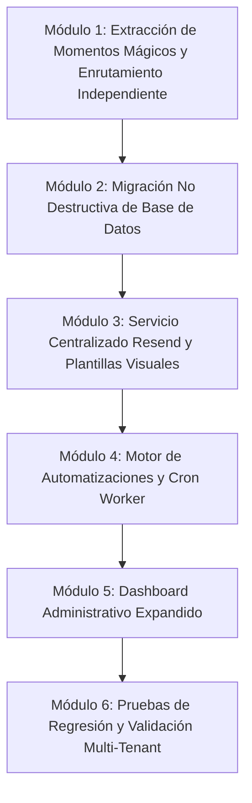

# INFORME Y PLAN DE IMPLEMENTACIÓN — FASE 2: GESTIÓN INTELIGENTE DE INVITADOS, RESEND Y EXPERIENCIA DIGITAL

**Fecha:** 26 de Noviembre de 2026  
**Proyecto:** Plataforma Multi-Tenant "XV Experience"  
**Celebración Principal:** Sophia Valentina Rivas Sánchez (`/e/sophia-xv`)  
**Celebración Protegida:** Angie Karolina (`/e/angie-xv`)  
**Rama Actual de Trabajo:** `feature/fase2-gestion-invitados-resend`  
**Punto de Restauración Establecido:** `fase1-estable-punto-restauracion` (`a3798c2`)  
**Estado:** **Fase de Planificación Finalizada — A la espera de autorización para ejecución**  

---

## 1. RESUMEN EJECUTIVO

Se ha completado la auditoría previa, el modelado arquitectónico y el diseño técnico detallado para la **Fase 2**.

El plan transforma la invitación digital existente en una plataforma integral de gestión de eventos, preservando al 100% la experiencia visual, emocional e interactiva de la Fase 1, sin alterar la celebración de Angie Karolina y asegurando cero regresiones en los 40 tests automatizados existentes.

Los entregables arquitectónicos generados en el repositorio son:
1. `AUDITORIA_PREVIA_FASE_2.md`: Diagnóstico exhaustivo de la plataforma actual.
2. `ARQUITECTURA_GESTION_INVITADOS.md`: Modelo relacional ampliado, doble modalidad de registro y enlaces mágicos seguros.
3. `INTEGRACION_RESEND.md`: Servicio centralizado con API oficial de Resend, webhooks Svix y plantillas HTML con identidad de Sophia.
4. `MOTOR_AUTOMATIZACIONES_EVENTOS.md`: Cola persistente de comunicaciones programadas con protección anti-vencidos.
5. `INFORME_IMPLEMENTACION_FASE_2.md`: Este documento con el plan de trabajo por etapas.

---

## 2. ROADMAP DE IMPLEMENTACIÓN POR MÓDULOS



---

### Módulo 1: Extracción de Momentos Mágicos y Enrutamiento Independiente
- **Objetivo:** Retirar la lámina 11 de la invitación principal (`public/index.php`) para dejar la invitación en 12 tarjetas puramente protocolares y elegantes.
- **Rutas a formalizar por celebración:**
  - `/e/{slug}`: Invitación digital pura (Portada, Padres, Cuenta Regresiva, Ceremonia, Recepción, Dress Code, Itinerario, Jardín Encantado / Minijuego de Mariposas, Playlist, Regalo, RSVP, Despedida).
  - `/e/{slug}/momentos`: Álbum interactivo y colaborativo standalone con carga de fotos/videos, dedicatorias y visualización comunitaria. Incluye pantalla de bienvenida con cuenta regresiva previa a la fiesta.
  - `/e/{slug}/recuerdos`: Grimorio 3D de recuerdos y dedicatorias.
  - `/e/{slug}/proyeccion`: Pantalla en vivo para proyector o pantalla gigante del salón.
- **Compatibilidad:** Se mantienen activas las rutas anteriores (`/libro/{slug}`, `/subir-fotos/{slug}`, `/en-vivo`) mediante redirección transparente.

---

### Módulo 2: Migración No Destructiva de Base de Datos
- **Mecanismo:** Script en `app/Core/DatabaseMigrationService.php` que verifica la existencia de cada columna antes de agregarla (`PRAGMA table_info` en SQLite / `information_schema` en MySQL).
- **Acciones:**
  1. Expandir `invitados`: agregar `email`, `telefono`, `grupo_familiar`, `pases_autorizados`, `estado_asistencia`, `token_seguro`, `fecha_confirmacion`, `preferencias_comunicacion`, `origen_registro`, `notas_admin`.
  2. Crear tabla `comunicaciones_log`: historial de envíos y trazabilidad de eventos.
  3. Crear tabla `automatizaciones_reglas`: definición de las 9 reglas de comunicación programada.
  4. Crear tabla `cola_automatizaciones`: cola persistente de envíos programados.
- **Generación de Tokens:** Generar tokens criptográficos retroactivos para los invitados existentes sin alterar sus IDs ni códigos de rifa.

---

### Módulo 3: Servicio Centralizado Resend y Plantillas Visuales
- **Mecanismo:** Crear `app/Services/ResendService.php` utilizando cURL nativo con soporte para `Idempotency-Key` y reintentos automáticos.
- **Plantillas HTML:**
  - Diseñadas bajo la **Paleta Autorizada de Sophia Valentina** (Marfil `#FFF3E7`, Rosa `#854761`, `#EBC5CC`, Champagne `#C5A16A`, Malva `#4A303B`, **cero verdes**).
  - Plantilla 1: Invitación Digital con Enlace Mágico.
  - Plantilla 2: Confirmación de Asistencia con Pase VIP y QR embebido.
  - Plantilla 3: Recordatorios Elegantes de Cuenta Regresiva (7 días, 3 días, 1 día, Hoy).
  - Plantilla 4: Invitación a compartir fotos en el Álbum en Vivo.
  - Plantilla 5: Agradecimiento de Sophia Valentina y familia.
- **Webhooks:** Implementar `api/webhooks/resend.php` con validación de firma criptográfica Svix HMAC-SHA256 para actualización de estados en tiempo real.

---

### Módulo 4: Motor de Automatizaciones y Cron Worker
- **Mecanismo:** Servicio `app/Services/AutomationEngineService.php`.
- **Cálculo de Fechas:** Basado en la zona horaria `America/Caracas` y la fecha de Sophia Valentina (21/12/2026 19:30).
- **Worker:** `cron/worker_automatizaciones.php` ejecutable vía CLI o cron programado.
- **Protección de Vencidos:** Descarte automático de correos cuyas fechas ya hayan expirado.

---

### Módulo 5: Dashboard Administrativo Expandido
- **Módulos en el Panel (`admin/index.php`):**
  - **Pestaña Invitados:** Lista con búsqueda en tiempo real, filtros por estado (`Confirmados`, `Pendientes`, `En Espera`, `No Asistirán`), edición de cupos y acompañantes, importador masivo CSV y exportador.
  - **Pestaña Comunicaciones:** Historial en vivo de envíos, tasas de entrega, aperturas, rebotes y fallos.
  - **Pestaña Automatizaciones:** Interruptores para activar, pausar o forzar cada una de las 9 reglas.
  - **Pestaña Momentos Mágicos & Moderación:** Acceso directo a moderación en lote, configuración de fecha de apertura del álbum y enlace de proyección.

---

### Módulo 6: Pruebas Automatizadas y Validación
- Ampliar `tests/suite_runner.php` de 40 a **50+ pruebas**:
  - P11.1 a P11.4: Enrutamiento independiente (`/momentos`, `/recuerdos`, `/proyeccion`).
  - P12.1 a P12.4: Registro público controlado, asignación de cupos y generación de tokens seguros.
  - P13.1 a P13.4: Simulación de cliente Resend (mock HTTP), prevención de duplicados e idempotencia.
  - P14.1 a P14.4: Encolado de automatizaciones, cálculo de zonas horarias y descarte de tareas vencidas.
  - P15.1: Ejecución completa de la suite de regresión de Angie Karolina (conservando su 100% de aislamiento).

---

## 3. DEPENDENCIAS Y VARIABLES DE ENTORNO REQUERIDAS

El proyecto no requiere instalar librerías externas pesadas ni modificar la versión de PHP (compatible con PHP 8.0, 8.1, 8.2 y 8.3).

Variables a configurar en `.env`:
```env
RESEND_API_KEY=re_tu_api_key_aqui
EMAIL_FROM="Sophia Valentina XV <invitaciones@xvexperience.com>"
EMAIL_REPLY_TO="eventos@xvexperience.com"
RESEND_WEBHOOK_SECRET=whsec_tu_webhook_secret_aqui
RESEND_ENVIRONMENT=sandbox # Cambiar a 'production' tras validación
```

---

## 4. MATRIZ DE RIESGOS Y MITIGACIÓN

| Riesgo | Probabilidad | Impacto | Estrategia de Mitigación |
| :--- | :---: | :---: | :--- |
| **Pérdida de datos en migración de BD** | Baja | Crítico | Respaldo previo de `invitacion_xv.sqlite`. Migraciones puramente aditivas (`ALTER TABLE ADD COLUMN`) con valores fallback. |
| **Regresión visual en Angie Karolina** | Baja | Alto | Scoping multi-tenant estricto mediante `$isSophia` y `body.theme-sophia-jardin`. Suite de 40 pruebas existente ejecutándose en cada cambio. |
| **Disparo accidental de correos vencidos** | Media | Alto | Regla de negocio en `AutomationEngineService`: `ignorar_vencidos = 1` por defecto. Toda tarea con fecha anterior a `NOW()` se cancela automáticamente. |
| **Rebotes de correos o spam** | Baja | Medio | Configuración de registros DNS (SPF, DKIM, DMARC), validación de sintaxis de correo y respeto de opt-out. |
| **Concurrencia en el worker cron** | Baja | Medio | Mecanismo de cerrojo de archivo (*file locking* con `flock`) para evitar ejecuciones paralelas. |

---

## 5. SOLICITUD DE AUTORIZACIÓN

De acuerdo con la instrucción prioritaria del usuario:
> *"Primero presentar la auditoría, arquitectura propuesta, dependencias y plan de implementación. Esperar autorización antes de realizar migraciones, activar correos reales, modificar producción o sincronizar cambios con el repositorio remoto."*

El punto de restauración se encuentra creado (`fase1-estable-punto-restauracion`), la rama de trabajo está lista (`feature/fase2-gestion-invitados-resend`) y los documentos arquitectónicos están formalizados.

**Quedamos a la espera de su confirmación para iniciar la ejecución del Módulo 1 (Desacoplamiento de Momentos Mágicos y Rutas Independientes).**
